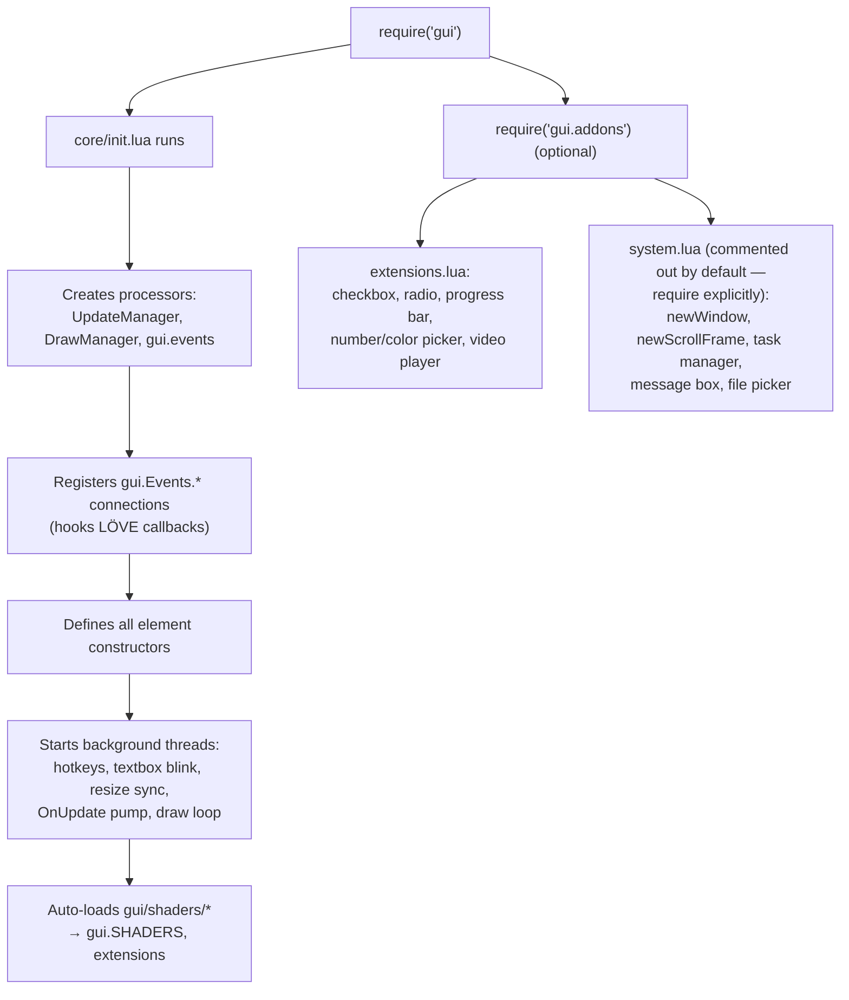

# GUI Library — Documentation Suite

Comprehensive documentation for the `gui` library: a LÖVE2D UI framework built on top of the [`multi`](../../multi) scheduler, featuring a dual-dimension layout system, a connection-based event bus, theming, shaders, declarative YAML UI, and a large widget add-on library.

> Source of truth: [`gui/init.lua`](../init.lua) (core), [`gui/core/`](../core) (support modules),
> [`gui/addons/`](../addons) (widgets), [`gui/shaders/`](../shaders) (GLSL effects),
> [`gui/yaml/`](../yaml) (declarative builder).

---

## Documentation Map

| Document | Contents |
|----------|----------|
| [Getting Started](gui-library-docs.md) | Quick start, minimal app skeleton, first widgets, common recipes |
| [Architecture & Internals](architecture.md) | Module map, frame loop, event routing, draw pipeline, threading model — with diagrams |
| [Layout System](layout-system.md) | The dual-dimension (`dualDim`) system: offsets + fractional scale, anchoring recipes |
| [Elements Reference](elements.md) | Frames, labels, buttons, textboxes, images, GIFs, video — constructors, properties, methods |
| [Events & Input](events-and-input.md) | Per-object events, global events, connections algebra, hotkeys, focus, drag state machine |
| [Appearance, Shapes & Shaders](appearance-and-shaders.md) | Color, roundness, form factors, blur, scissor clipping, built-in shader library |
| [Theming & Color](theming-and-color.md) | `color` module, palettes, generated themes, presets, hue-wheel slot model |
| [Widgets (Add-ons)](widgets.md) | Window, scroll frame, checkbox, radio group, progress bar, number picker, color picker, video player, task manager, message box, file picker, menus |
| [YAML Declarative UI](yaml-declarative-ui.md) | Building element trees from YAML; full schema reference |
| [Core Modules](core-modules.md) | `font`, `gifloader`, `transitions`, `canvas`, `menus`, `probe`, `simulate` |
| [API Quick Reference](api-quick-reference.md) | Condensed one-line-per-entry tables of the entire public surface |

---

## Library Layout

```
gui/
├── init.lua            # Core library: elements, layout, events, draw pipeline
├── core/
│   ├── canvas.lua      # Full-frame root canvases + child-tree swap
│   ├── color.lua       # Color parsing, math, palettes, ~1000 named colors
│   ├── font.lua        # Font object cache
│   ├── gifloader.lua   # Pure-Lua GIF decoder (LZW) + frame animator
│   ├── menus.lua       # Menu registry (lazy build, hide/show)
│   ├── probe.lua       # Scheduler load probe
│   ├── simulate.lua    # Synthetic mouse input for testing
│   ├── theme.lua       # Generated palettes + 12 presets
│   └── transitions.lua # Interpolation engine (glide)
├── addons/
│   ├── init.lua        # Loads `extensions` (system is opt-in)
│   ├── extensions.lua  # Video player, checkbox, radio, progress bar, pickers
│   ├── system.lua      # Window, scroll frame, task manager, message box, file picker (opt-in)
│   └── extensions_old.lua  # Legacy: slider, tooltip, list/grid frames (not loaded)
├── shaders/
│   ├── shaders.lua     # 13 built-in shader effects (auto-registered on gui.SHADERS)
│   └── blur.lua        # setBlur/clearBlur extension (2-pass gaussian)
├── yaml/
│   ├── builder.lua     # YAML table → element tree
│   ├── tinyyaml.lua    # Bundled YAML parser
│   └── toyaml.lua      # Element tree → YAML serializer
├── assets/             # play.png / pause.png (video player)
└── docs/               # ← you are here
```

## Loading Order & What Gets Registered When



> **Gotcha:** `gui/addons/init.lua` only requires `gui.addons.extensions`.
> The widgets defined in `gui/addons/system.lua` (`newWindow`, `newScrollFrame`,
> `newMessageBox`, `showTaskManager`, `newFilePicker`) require an explicit
> `require("gui.addons.system")`. See [Widgets](widgets.md).
