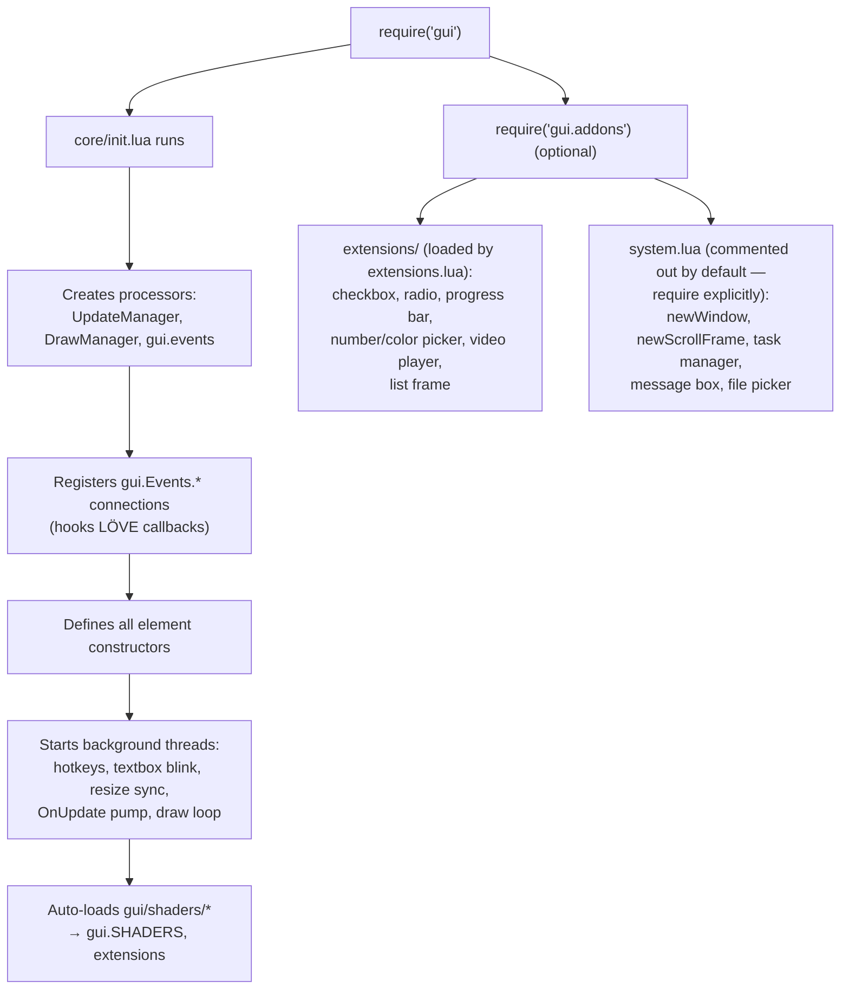

# GUI Library — Documentation Suite

Comprehensive documentation for the `gui` library: a LÖVE2D UI framework built on top of the [`multi`](../../multi) scheduler, featuring a dual-dimension layout system, a connection-based event bus, theming, shaders, declarative YAML UI, and a large widget add-on library.

> Source of truth: [`gui/init.lua`](../init.lua) (core), [`gui/core/`](../core) (support modules),
> [`gui/addons/`](../addons) (widgets), [`gui/shaders/`](../shaders) (GLSL effects),
> [`gui/yaml/`](../yaml) (declarative builder).

---

## Documentation Map

| Document | Contents |
|----------|----------|
| [Getting Started](getting-started.md) | Quick start, minimal app skeleton, first widgets, common recipes |
| [Architecture & Internals](architecture.md) | Module map, frame loop, event routing, draw pipeline, threading model — with diagrams |
| [Layout System](layout-system.md) | The dual-dimension (`dualDim`) system: offsets + fractional scale, anchoring recipes |
| [Flexbox Layout](flexbox.md) | Opt-in auto-layout (Clay port): `setFlex`/`setSizing`, escape hatch, fit-content text, scroll integration |
| [Grid Layout](grid.md) | Opt-in CSS-Grid-style containers/items (`setGrid`/`setGridPlacement`) riding the flex scheduler: tracks, areas, placement, alignment, cross-mode nesting |
| [Elements Reference](elements.md) | Frames, labels, buttons, textboxes, images, GIFs, video — constructors, properties, methods |
| [Events & Input](events-and-input.md) | Per-object events, global events, connections algebra, hotkeys, focus, drag state machine |
| [Appearance, Shapes & Shaders](appearance-and-shaders.md) | Color, roundness, form factors, blur, scissor clipping, built-in shader library |
| [Theming & Color](theming-and-color.md) | `color` module, palettes, generated themes, presets, hue-wheel slot model |
| [Widgets (Add-ons)](widgets.md) | Window, scroll frame, checkbox, radio group, progress bar, number picker, color picker, video player, task manager, message box, file picker, menus |
| [YAML Declarative UI](yaml-declarative-ui.md) | Building element trees from YAML; full schema reference (incl. `flex:`/`sizing:` and `grid:`/`grid-placement:` keys) |
| [Core Modules](core-modules.md) | `font`, `gifloader`, `svgloader`, `transitions`, `canvas`, `menus`, `probe`, `simulate` |
| [API Quick Reference](api-quick-reference.md) | Condensed one-line-per-entry tables of the entire public surface |

---

## Library Layout

Directory-level map only — per-module behavior is documented in the guides above,
so this tree stays short on purpose (file-by-file detail here just drifts):

```
gui/
├── init.lua            # Core library: elements, layout, events, draw pipeline
├── core/               # color, theme, font, transitions, gif/svg loaders, canvas,
│                       # menus, simulate, probe, flexbox, grid, measure
├── addons/             # Widget add-ons: extensions/ (auto-loaded) + system.lua (opt-in)
├── shaders/            # shaders.lua (gui.SHADERS registry) + blur.lua extension
├── yaml/               # Declarative builder, bundled tinyyaml parser, toyaml serializer
├── assets/             # play.png / pause.png (video player)
├── examples/           # Demo apps: flex-demo, grid-demo, list-demo, svg-demo
└── docs/               # ← you are here
```

## Loading Order & What Gets Registered When



> **Gotcha:** `gui/addons/init.lua` only requires `gui.addons.extensions`.
> The widgets defined in `gui/addons/system.lua` (`newWindow`, `newScrollFrame`,
> `newMessageBox`, `showTaskManager`, `newFilePicker`) require an explicit
> `require("gui.addons.system")`. See [Widgets](widgets.md).
