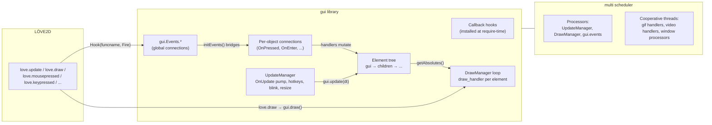
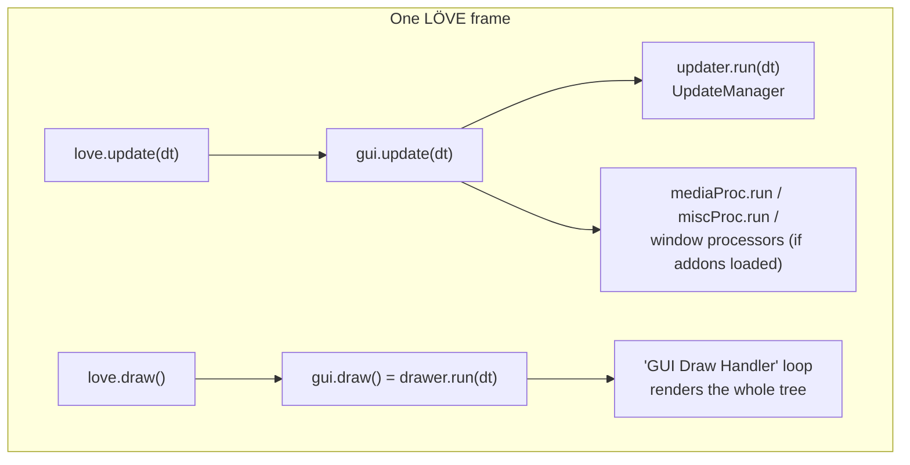
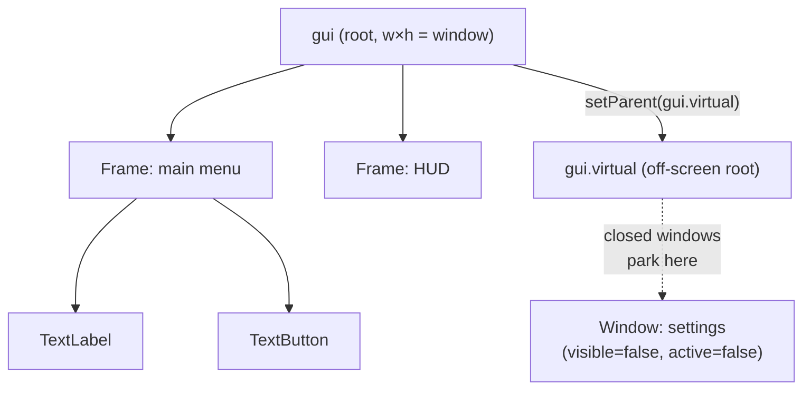
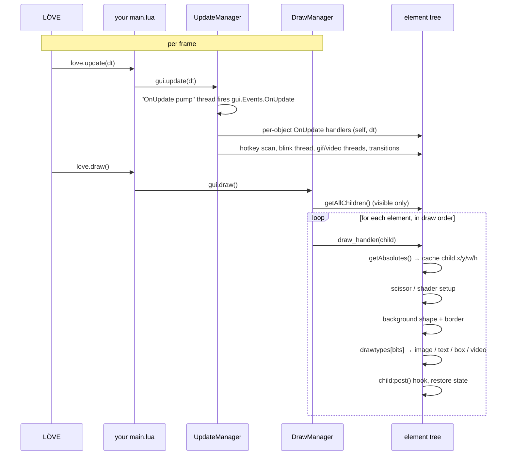
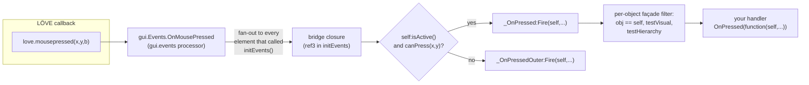
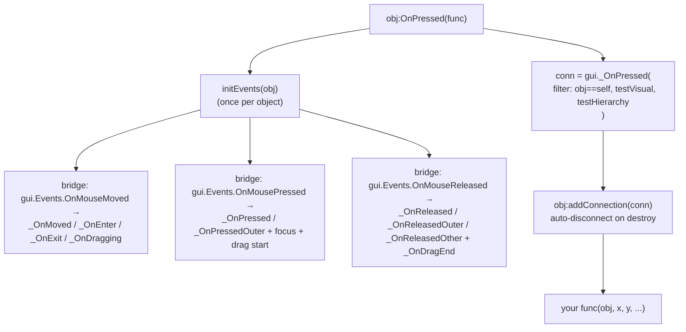
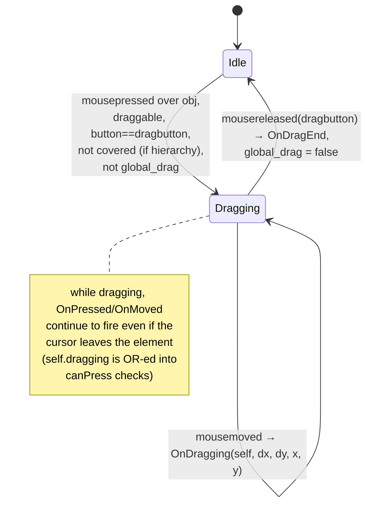
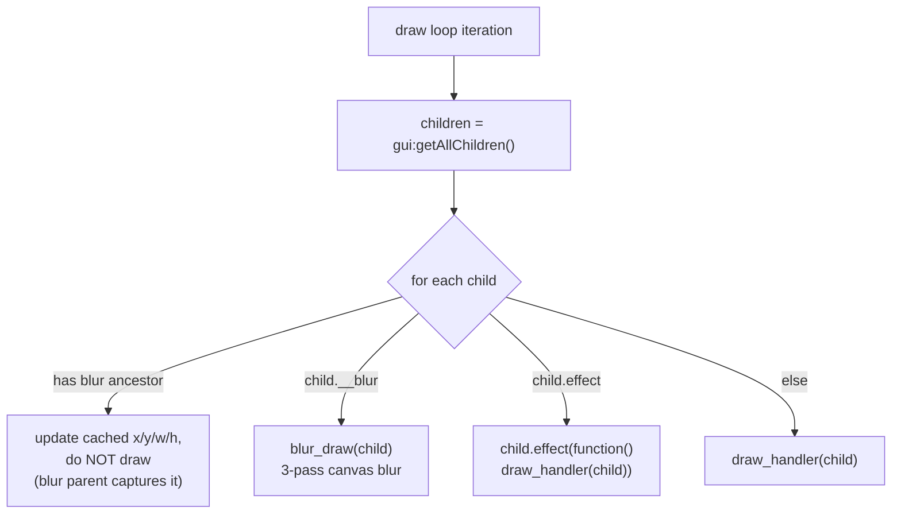
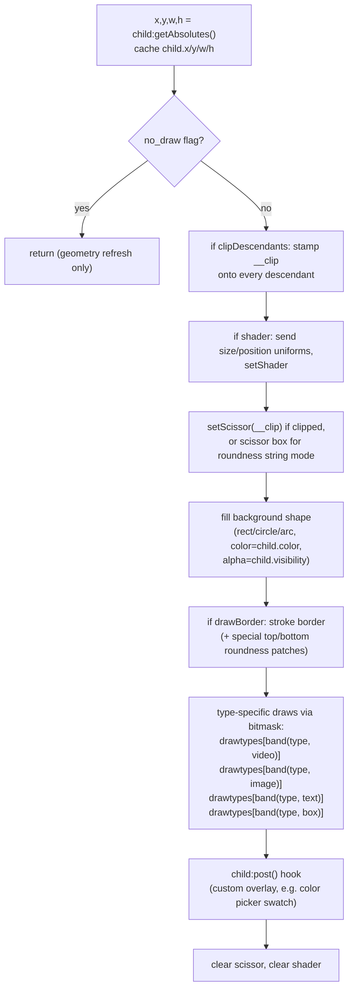

# Architecture & Internals

This document explains how the `gui` library is put together: how it layers on top of the
[`multi`](../../multi/docs/Documentation.md) scheduler, how input events are routed from LÖVE
callbacks to per-element handlers, how the draw pipeline works, and which background threads
run behind the scenes.

Code references point into [`gui/init.lua`](../init.lua) and the modules under
[`gui/core/`](../core).

---

## Table of Contents

1. [Big Picture](#1-big-picture)
2. [Processors: the three schedulers](#2-processors-the-three-schedulers)
3. [The object tree: `gui` and `gui.virtual`](#3-the-object-tree-gui-and-guivirtual)
4. [Frame lifecycle: update & draw](#4-frame-lifecycle-update--draw)
5. [Event routing](#5-event-routing)
6. [The per-object event façade](#6-the-per-object-event-façade)
7. [Focus model](#7-focus-model)
8. [Drag state machine](#8-drag-state-machine)
9. [The draw pipeline](#9-the-draw-pipeline)
10. [Type bitmasks](#10-type-bitmasks)
11. [Background threads](#11-background-threads)
12. [Hotkey engine](#12-hotkey-engine)
13. [Image caching & async loading](#13-image-caching--async-loading)
14. [Extension & registration system](#14-extension--registration-system)
15. [Known caveats](#15-known-caveats)

---

## 1. Big Picture

The library is a singleton tree of UI elements. Everything is driven by the `multi`
cooperative scheduler: connections (signals), threads (coroutines), and processors
(schedulers) do the heavy lifting. LÖVE's callbacks are *hooked*, not wrapped by the user.



Minimal integration (from your game code):

```lua
local gui = require("gui")

function love.update(dt) gui.update(dt) end   -- runs UpdateManager processors
function love.draw()     gui.draw()     end   -- runs DrawManager processors
```

Everything else (input forwarding, resizing, hotkeys, focus) is automatic — the library
installs hooks on the LÖVE callbacks at require time
([`init.lua` L98–151](../init.lua:98)).

---

## 2. Processors: the three schedulers

A `multi` *processor* is an independent cooperative scheduler. The core creates three
([`init.lua` L8–10](../init.lua:8)):

| Processor | Variable | Role |
|-----------|----------|------|
| `UpdateManager` | `updater` | Runs all logic threads/loops/functions: hotkey manager, textbox blink, resize sync, `OnUpdate` pump, element threads, async image loads, transitions |
| `DrawManager` | `drawer` | Runs the draw loop (one `newLoop` that renders the whole tree) plus the geometry-refresh poll thread |
| `gui.events` | `core_conns` | Hosts every global connection in `gui.Events.*` (fast-mode connections) |

`gui.update(dt)` runs the registered update processors; `gui.draw()` runs the draw
processor ([`init.lua` L2444–2454](../init.lua:2444)):

```lua
local processors = { updater.run }

gui.draw   = drawer.run
gui.update = function(dt)
    for i = 1, #processors do processors[i](dt) end
end
```

Additional processors can be added at runtime with `gui:newProcessor(name)` — their `run`
is appended to the same list ([`init.lua` L2456–2460](../init.lua:2456)). Add-on modules use
this to isolate their workloads (e.g. `media-updater`, `misc-updater` in
[`addons/extensions.lua`](../addons/extensions.lua:5), one `window_N` processor per
[`newWindow`](../addons/system.lua:441)).



---

## 3. The object tree: `gui` and `gui.virtual`

There are two roots ([`init.lua` L2462–2490](../init.lua:2462)):

- **`gui`** — the visible root. Its `w`/`h` mirror the window (or the letterboxed area when
  aspect ratio is locked).
- **`gui.virtual`** — an off-screen root. Elements parented here still *update* (threads,
  timers, layout math) but are **never drawn** and are excluded from `isActive()` hit tests.
  This is how the library "hides without destroying": windows close by re-parenting their
  header to `gui.virtual`.



Key invariants:

- `gui.parent = gui` and `gui.virtual.parent = gui.virtual` (self-parented roots) so
  `getAbsolutes()` works uniformly at any depth.
- `obj:isActive()` = `obj.active and not obj:isDescendantOf(gui.virtual)`
  ([`init.lua` L570](../init.lua:570)).
- `obj:isDescendantOf(other)` walks the `parent` chain up to the roots
  ([`init.lua` L349](../init.lua:349)).
- The roots' geometry is refreshed every frame by a dedicated thread
  ([`init.lua` L2517–2548](../init.lua:2517)) — see [resize & aspect ratio](#resize-and-aspect-ratio).

### Constructors attach to `self`

Every constructor is called *on* a parent: `parent:newFrame(...)` inserts the child into
`parent.children` and sets `child.parent` ([`newBase`, init.lua L1069–1107](../init.lua:1069)).
Passing `virtual = true` (`newVirtualFrame`) parents to `gui.virtual` instead.

---

## 4. Frame lifecycle: update & draw



Two caches are maintained for you, every frame or on geometry changes:

- `child.x, child.y, child.w, child.h` — the resolved absolutes, written by `draw_handler`
  ([`init.lua` L2215–2218](../init.lua:2215)). These are what *parents* use in the layout
  formula, so a child's absolute position depends on the parent having been drawn first.
- A separate "Draw Handler" thread re-runs `draw_handler(child, no_draw=true, 0)` for the
  **virtual** tree every 100 ms ([`init.lua` L2433–2442](../init.lua:2433)) so parked
  windows still keep their cached geometry current.

---

## 5. Event routing

At require time, every relevant LÖVE callback is hooked to fire the matching connection in
`gui.Events` ([`init.lua` L111–151](../init.lua:111)). The hook helper chains onto an
existing user callback if you defined one:

```lua
local function Hook(funcname, func)
    if love[funcname] then
        local cache = love[funcname]
        love[funcname] = function(...) cache(...) func({}, ...) end
    else
        love[funcname] = function(...) func({}, ...) end
    end
end
```

> Hooking happens *inside an updater task*, so if your `main.lua` defines `love.keypressed`
> yourself, the library chains after it rather than clobbering it.



The global connections and their LÖVE sources (all `fastmode`):

| `gui.Events` connection | LÖVE source / origin |
|---|---|
| `OnQuit`, `OnDirectoryDropped`, `OnDisplayRotated`, `OnFilesDropped`, `OnFocus`, `OnResized`, `OnVisible`, `OnMouseFocus` | system callbacks |
| `OnKeyPressed/Released`, `OnTextEdited/OnTextInputed` | keyboard |
| `OnMouseMoved/Pressed/Released`, `OnWheelMoved` | mouse |
| `OnTouchMoved/Pressed/Released` | touch |
| `OnGamepadPressed/Released/Axis`, `OnJoystickAdded/Removed/Pressed/Released/Hat` | gamepad/joystick |
| `OnCreated` | fired internally by element constructors |
| `OnObjectFocusChanged` | fired internally on focus moves |
| `OnUpdate` | fired by an internal pump thread, once per update tick |

Full signature tables live in [Events & Input](events-and-input.md).

---

## 6. The per-object event façade

There is **one global connection per event name** shared by all objects (`gui._OnPressed`,
`gui._OnEnter`, …), created in the loops at
[`init.lua` L1017–1066](../init.lua:1017). What you call as
`obj:OnPressed(func)` is a metatable façade that:

1. Calls `initEvents(self)` once per object — installing three bridge connections to the
   global mouse connections ([`init.lua` L920–983](../init.lua:920));
2. Connects your `func` to the shared `_On<Event>` connection behind a filter closure.

The filter differs by event class:

| Class | Events | Filter applied |
|---|---|---|
| **Basic** | `OnLoad`, `OnDestroy`, `OnVideoFinished` | `obj == self` |
| **Hierarchy** | `OnPressed`, `OnReleased`, `OnEnter`, `OnMoved` | `obj == self` **and** `testVisual(obj)` **and** `obj:testHierarchy(x, y)` |
| **Visual** | everything else (`OnExit`, `OnDrag*`, `OnSizeChanged`, stick events, …) | `testVisual(obj)` |



Notes:

- `testVisual(c)` = the object and none of its ancestors carries the `"visual"` tag —
  visual frames and their subtrees ignore mouse semantics
  ([`init.lua` L642](../init.lua:642)).
- `testHierarchy` returns `true` unless the object opted into `respectHierarchy(true)`
  **and** something else is under the cursor (`isBeingCovered`) or a global drag is active
  ([`init.lua` L820–829](../init.lua:820)).
- Every bridge/filter connection is recorded via `addConnection`, and `destroy()`
  `Unconnect`s them all ([`init.lua` L727–731](../init.lua:727)).

### Hit testing

`canPress(mx, my)` tests the point against the element's absolutes — intersected with its
scissor clip if a `clipDescendants` ancestor set one
([`init.lua` L470–480](../init.lua:470)).
`isBeingCovered(mx, my, respect)` walks the *global* visible child list back-to-front and
returns true if a later (higher) element under the cursor would take the click; elements
with `ignore = true` are skipped ([`init.lua` L482–493](../init.lua:482)).

---

## 7. Focus model

- `object_focus` is a module-level variable, initially `gui` itself
  ([`init.lua` L20](../init.lua:20)).
- On any successful press, if the pressed object differs from the current focus,
  `gui.Events.OnObjectFocusChanged:Fire(previous, current)` fires and focus moves
  ([`init.lua` L963–967](../init.lua:963)).
- Read it with `gui:getObjectFocus()`. There is no programmatic focus setter yet —
  the README lists `gui.focus.set/get/clear` as a planned API.
- Textboxes gate their keyboard behavior on `object_focus:hasType(box)`; the blink thread
  and the edit handlers all read `object_focus`
  ([`init.lua` L1743–1841](../init.lua:1743)).
- `bar_show` drives the caret: the blink thread toggles it on the focused box.

---

## 8. Drag state machine

Dragging is per-object (`obj.draggable`, `obj.dragbutton`, default button **2 / right
button**) plus a module-level `global_drag` latch that prevents two simultaneous drags
([`init.lua` L957–978](../init.lua:957), [L940–946](../init.lua:940)).



Enable with `obj:enableDragging(gui.MOUSE_PRIMARY)`; disable with `enableDragging(false)`.

---

## 9. The draw pipeline

### Top-level loop

The `DrawManager` runs a single named loop, `GUI Draw Handler`
([`init.lua` L2408–2431](../init.lua:2408)), iterating `gui:getAllChildren()` — a flat,
depth-first, **visible-only** list where parents precede children, which also defines paint
order (later = on top; see `topStack`/`bottomStack`).



### `draw_handler` (the per-element renderer)

[`init.lua` L2206–2315](../init.lua:2206):



`drawtypes` is a table keyed by type bit: `[1]` image (incl. GIF frames + flip),
`[2]` text (`love.graphics.printf` with align/scale/shear), `[4]` caret + selection
highlight, `[8]` video ([`init.lua` L2092–2192](../init.lua:2092)). A composite element
(e.g. textbox = `text + box`) runs both the `[2]` and `[4]` passes because each pass is
selected with `band(type, bit)`.

### Blur pass

Any element with `__blur` (installed by the [`shaders/blur.lua`](../shaders/blur.lua:49)
extension via `setBlur(radius)`) renders through a 3-pass pipeline
([`blur_draw`, init.lua L2328–2406](../init.lua:2328)):

```
Pass 1: draw element + all descendants onto canvas1 (translated into canvas space)
Pass 2: canvas1 → canvas2 through horizontal gaussian (shader_h)
Pass 3: canvas2 → screen through vertical gaussian (shader_v)
```

Descendants of a blurred element are skipped by the top-level loop so they aren't drawn
twice.

### Resize & aspect ratio

A thread yields each update and rewrites the roots' `w/h` and `dualDim` offsets
([`init.lua` L2517–2548](../init.lua:2517)). When `gui.aspect_ratio = true` and
`gui:setAspectSize(W, H)` was called, the root is letterboxed with
`GetSizeAdjustedToAspectRatio` — `gui.x/gui.y` become the letterbox offset and everything
laid out in fractions of the root automatically scales to the safe area.

---

## 10. Type bitmasks

Each element's numeric `type` is a **bitmask** of capability flags
([`init.lua` L18, L30–36](../init.lua:18)):

| Flag | Value | Meaning |
|---|---|---|
| `frame` | 0 | plain container (no bits) |
| `image` | 1 | has `.image`/`.quad` rendering |
| `text` | 2 | has text/font rendering |
| `box` | 4 | editable/caret behavior |
| `video` | 8 | has `.video` rendering |
| `button` | 16 | marker: interactive |
| `anim` | 32 | reserved (unused) |

`obj:hasType(t)` = `band(obj.type, t) == t` ([`init.lua` L285](../init.lua:285)).
Examples: `newTextLabel` → `text + frame` = 2; `newTextBox` → `text + box` = 6;
`newTextButton` → `text + button` = 18; `newImageLabel` → `image + frame` = 1.

The bitmask drives both draw-pass selection and theme auto-styling in `newWindow`
(`hasType(TYPE_BUTTON)` etc.).

---

## 11. Background threads

The core spawns these `multi` threads (all on the UpdateManager unless noted):

| Thread | Location | Purpose |
|---|---|---|
| Hook installer task | [L111](../init.lua:111) | Runs once; chains LÖVE callbacks |
| `GUI Hotkey Manager` | [L172](../init.lua:172) | Polls hotkey key-down sets, fires matches (see §12) |
| `Textbox Handler` | [L1743](../init.lua:1743) | Blinks the caret of a focused, blink-enabled box (0.5 s on/off) |
| Draw Handler (DrawManager) | [L2433](../init.lua:2433) | Refreshes virtual-tree geometry every 0.1 s |
| Resize/aspect sync | [L2517](../init.lua:2517) | Keeps `gui`/`gui.virtual` geometry pinned to the window |
| `OnUpdate` pump | [L2551](../init.lua:2551) | Skips one cycle per update, then fires `gui.Events.OnUpdate` |
| Per-video `Video Handler` | [L2066](../init.lua:2066) | Watches `video:tell()` to fire `OnVideoFinished` |
| Per-gif `Gif Handler` | [gifloader.lua L342](../core/gifloader.lua:342) | Advances `gif.currentFrame` per frame delays |
| Per-centering center loop | [L858](../init.lua:858) | Keeps `centerX/centerY` elements centered as the parent resizes |

Threads are the library's concurrency primitive: `thread.sleep`, `thread.hold(pred)`,
`thread.skip(n)`, `thread.chain`, `thread.kill` — see the
[multi threading API](../../multi/docs/threading-api.md).

---

## 12. Hotkey engine

`obj:setHotKey({"lctrl","a"}, conn)` registers a key *set* (all keys must be held)
([`init.lua` L194–200](../init.lua:194)). The hotkey thread:

```
loop:
  hold until any hotkey registered
  for each registered combo:
     if every key isDown and combo not busy:
        Fire(combo.Connection, ref=owner)   → owner passed to handlers
        mark busy; unPress() waits for key release
  sleep 1 ms
```

Connections compose with multi's algebra: `+` is OR, `*` is AND — which is how
`gui.HotKeys.OnRedo` unions six different chord spellings
([`init.lua` L221–226](../init.lua:221)). Built-ins: `OnSelectAll`, `OnCopy`, `OnPaste`,
`OnCut`, `OnUndo`, `OnRedo`. The task-manager add-on registers <kbd>Ctrl+`</kbd>
([`addons/system.lua` L1068](../addons/system.lua:1068)).

---

## 13. Image caching & async loading

- `image_cache[path] → ImageData/Image` is consulted by `getTile` and `setImage`
  ([`init.lua` L430–446](../init.lua:430), [L1960](../init.lua:1960)).
- `gui:cacheImage(pathOrList)` loads through `THREAD:newFunction` **off the main thread**
  and stores results in the cache; a list variant reports progress via
  `handler.OnStatus(part, whole, img)` ([`init.lua` L1845–1873](../init.lua:1845)).
- GIFs bypass the cache: `setImage("*.gif")` routes to
  [`gifloader.load`](../core/gifloader.lua:103) (pure-Lua LZW decoder) and registers an
  `OnDestroy` hook to kill the gif thread.

---

## 14. Extension & registration system

`gui.registerExtension(template)` stores a table of methods that get **copied onto every
new element** in `newBase` ([`init.lua` L646–658](../init.lua:646)). This is how the blur
shader ships `setBlur`/`clearBlur`/`setBlurRadius` without touching the core metatable
([`shaders/blur.lua` L47–71](../shaders/blur.lua:47)). All files in `gui/shaders/` are
auto-loaded at require time and each exposes an `init(gui)` function
([`init.lua` L2558–2562](../init.lua:2558)) — `shaders.lua` populates the `gui.SHADERS`
registry, `blur.lua` registers the extension.

Add-ons instead extend `gui` directly (`function gui:newCheckbox(...)`), which is why
`require("gui.addons")` has no return value.

---

## 15. Known caveats

Documented so they don't surprise you; several are also tracked in
[`gui/fixes.md`](../fixes.md):

- `newImageButton` creates an `image + frame` element (the `button` bit is not set), so
  `hasType(TYPE_BUTTON)` is false for image buttons; theming in `newWindow` keys off
  `TYPE_BUTTON` and won't restyle them.
- `clone()` reads `u.Do[2]` but image uniques store the key as `DO` — cloning image
  elements loses their source. (Use `setImage` on the clone.)
- `fitFont` caches and binary-searches correctly but the final `bestFont` line can
  reference the stale loop `mid` — pass an `opt` table with `scale` or accept the default.
- `getLocalCords` leaks globals (`x, y, w, h` not `local`) — harmless but pollutes `_G`.
- The shader loader variable `files` is global too.
- `hasType(button)` on composite types requires *all* bits (`band == t`), so
  `text + button` matches `hasType(button)` only because `button` is a single bit.

See [Events & Input](events-and-input.md#gotchas) and [Elements](elements.md) for
workarounds around each.
