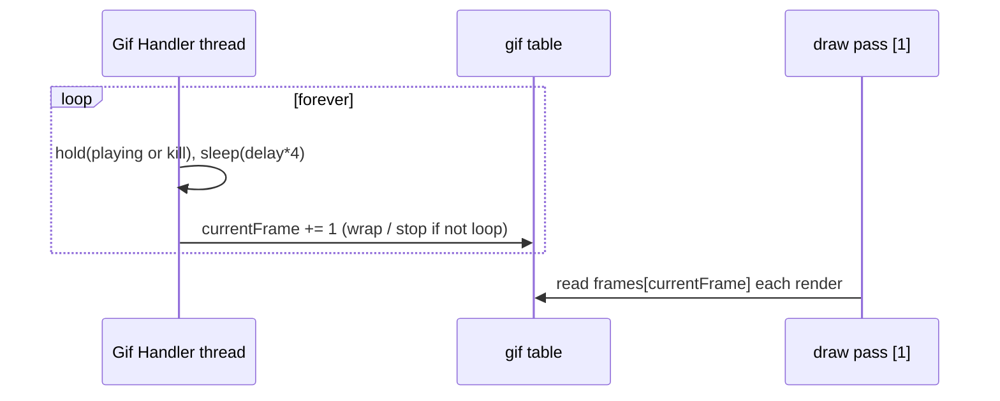

# Core Support Modules

The [`gui/core/`](../core) modules that aren't color/theme (covered in
[theming-and-color.md](theming-and-color.md)).

---

## Table of Contents

1. [font — cached font loader](#1-font--cached-font-loader)
2. [transitions — interpolation engine](#2-transitions--interpolation-engine)
3. [gifloader — GIF decoder & animator](#3-gifloader--gif-decoder--animator)
4. [canvas — full-frame roots](#4-canvas--full-frame-roots)
5. [menus — menu registry](#5-menus--menu-registry)
6. [simulate — synthetic input](#6-simulate--synthetic-input)
7. [probe — scheduler load](#7-probe--scheduler-load)

---

## 1. font — cached font loader

[`core/font.lua`](../core/font.lua). A tiny cache keyed by `"path:size"` so repeated
`setFont`/`fitFont` calls don't churn LÖVE font objects.

```lua
local font = require("gui.core.font")

local f = font.set("assets/fonts/gyparody.ttf", 24)  -- load-or-fetch, returns Font
local d = font.set(nil, 16)                          -- default face at 16
local g = font.get("assets/fonts/gyparody.ttf", 24)  -- fetch without loading twice

font.evict(nil, 16)      -- drop one entry
font.clear()             -- drop all
print(font.size())       -- entries cached
```

The core uses this internally when `scaleFont` re-derives a font at draw time
([`init.lua` L2136](../init.lua:2136)).

---

## 2. transitions — interpolation engine

[`core/transitions.lua`](../core/transitions.lua). Runs on its own `Transition Processor`.
A transition **factory** is created by calling a transition with `(start, stop, duration)`;
calling the factory starts the animation and returns a handle.

```lua
local transition = require("gui.core.transitions")

-- glide = linear interpolation (the built-in)
local slide = transition.glide(-200, 0, 0.3)   -- factory: -200 → 0 over 0.3 s

local t = slide()                              -- start it
t.OnStep(function(value, elapsed)              -- fires at the transition's FPS
    panel:rawSetDualDim(value)
end)
t.OnStop(function() print("done") end)         -- OnReturn + OnError combined
t.Kill()                                       -- cancel mid-flight
```

- **Factory overrides:** `slide(newStart, newStop, newDuration)` — any nil falls back to
  the original values.
- **Trivial case:** `start == stop` short-circuits (fires `OnStop` next task, no thread).
- **FPS control:** `transition.glide:SetFPS(30)` / `:GetFPS()` — sample rate of `OnStep`.

### Custom transitions

`transition:newTransition(func)` wraps a coroutine body that pushes values via
`thread.pushStatus`:

```lua
local ease = transition:newTransition(function(t, start, stop, time)
    local steps = t.fps * time
    t.running = true
    for i = 0, steps do
        if t.kill then break end
        thread.sleep(1 / t.fps)
        local u = i / steps
        local eased = 1 - (1-u)*(1-u)               -- easeOutQuad
        thread.pushStatus(start + (stop - start) * eased, u)
    end
    t.running = false
    t.kill = false
end])
```

The README's "Better Transitions" list (easeInOut, bounce, elastic, back, cubic variants)
is planned — only `glide` ships today; the `newTransition` pattern above is how to add
them.

Used internally by [`simulate.Move`](#6-simulate--synthetic-input).

---

## 3. gifloader — GIF decoder & animator

[`core/gifloader.lua`](../core/gifloader.lua). Pure-Lua GIF87a/89a decoder (LZW included —
LÖVE's `love.data` doesn't do LZW). Image elements wire this automatically for `.gif`
sources ([elements §4.3](elements.md#43-animated-gifs)); standalone API:

```lua
local gif = require("gui.core.gifloader")

local g = gif.load("assets/anim.gif")   -- {frames, delays, currentFrame, width, height, ...}

-- choose ONE driving model:
gif.Updater(g, drawer)                  -- spawns a "Gif Handler" thread on a processor
-- or, in your own update loop:
gif.update(g, love.timer.getDelta())

gif.draw(g, x, y, r, sx, sy, ox, oy)    -- draw current frame
gif.play(g) / gif.pause(g) / gif.reset(g)
gif.setFixedFramerate(g, 24)            -- override all per-frame delays
print(gif.getInfo(g))                   -- {width, height, frameCount, delays, totalDuration}
```

Decoding notes:

- Frames are **composited**: each frame's `ImageData` starts as a copy of the previous
  frame, then the frame's dirty rectangle is painted (handles partial frames &
  transparency index).
- Delay policy: 0 → 100 ms; ≤2 cs → 20 ms floor; else `delay/100` s. NaN/zero delays are
  sanitized after parse.
- `gif.kill = true` terminates a thread-driven gif (the element does this on `destroy`).
- Interlaced GIFs are parsed but not de-interlaced.
- `gif.Updater` sleeps `delay * 4` — thread-driven playback runs ~4× slower than the
  encoded delays; use `gif.update(g, dt)` for accurate timing.



---

## 4. canvas — full-frame roots

[`core/canvas.lua`](../core/canvas.lua). The module *is* the constructor function:

```lua
local newCanvas = require("gui.core.canvas")

local bg   = newCanvas("visual")   -- non-interactive full-screen frame
local root = newCanvas()           -- interactive full-screen frame
```

Each canvas fills the screen (`fullFrame()`) and gains:

```lua
newCanvas:swap(a, b)   -- exchange the children tables of a and b, re-parenting both
```

`swap` is the scene-transition primitive: build the next screen off in a virtual canvas,
then swap it with the live one in one step.

---

## 5. menus — menu registry

Lazy, single-visible menu manager. Full API documented in
[widgets §11](widgets.md#11-menu-registry-core).

Key behaviors: `registerMenu(name, buildFn[, delete])` stores a factory; the first
`:visible(true, ...)` builds the frame inside the current menu container, subsequent calls
just re-show it; `hideMenus()` parks (or destroys, with `delete`) the others.

---

## 6. simulate — synthetic input

Drive the GUI from scripts/tests ([`core/simulate.lua`](../core/simulate.lua)); practical
guide in [events §10](events-and-input.md#10-simulation-synthetic-input).

```lua
local simulate = require("gui.core.simulate")

simulate:Press()                 -- at current mouse pos, primary button
simulate:Release()
simulate:Press(nil, 400, 300)    -- explicit position
btn:Press()                      -- object form → object center
simulate.Click(btn)              -- press → tick → release (async, scheduler function)
simulate.Move(nil, 100, 0, sx, sy)  -- animated cursor glide + OnMouseMoved stream
```

`Move` glides the real OS cursor with two `glide` transitions and fires the moved event
stream, so hover/drag chains behave as with a human.

---

## 7. probe — scheduler load

[`core/probe.lua`](../core/probe.lua) replaces `multi:getLoad()` with a cheap,
non-blocking estimate. Despite the header's tick-slip theory, the installed
implementation measures **FPS shortfall vs. refresh rate**:

```lua
local probe = require("gui.core.probe")
probe:install(multi)          -- once, at startup

local loadPct, frameMs = multi:getLoad()     -- e.g. 12, 16.6
local lagMs, ratio     = multi:getSchedulerLag()
```

| `opts` | default | note |
|---|---|---|
| `interval` | 0.05 | accepted but unused by the installed FPS-based getter |
| `alpha` | 0.15 | EMA smoothing (state kept for diagnostics) |
| `maxLag` | 0.1 | lag seconds that would map to 100 % |

`load% = ceil((1 - fps/targetFPS) * 100)`, clamped at 0. The task-manager add-on displays
this as its load bar.
