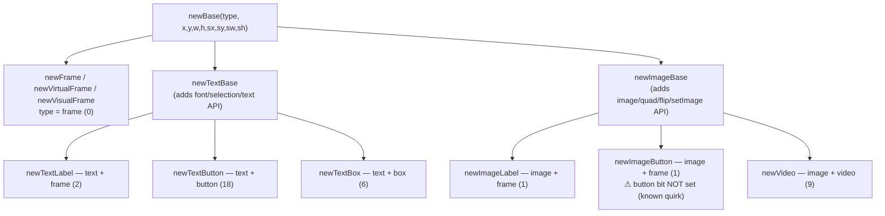

# Elements Reference

All core element constructors live in [`gui/init.lua`](../init.lua) and are called **on a
parent object** (`gui` or any element). Every constructor shares the same positional tail:

```lua
parent:newXxx(..., x, y, w, h, sx, sy, sw, sh)   -- dualDim, see layout-system.md
```

Constructors register the child in `parent.children`, fire `gui.Events.OnCreated`, and run
any registered [extensions](architecture.md#14-extension--registration-system).

---

## Table of Contents

1. [Element family tree](#1-element-family-tree)
2. [Frames](#2-frames)
3. [Text elements](#3-text-elements)
   - [TextLabel](#31-textlabel) · [TextButton](#32-textbutton) · [TextBox](#33-textbox) · [TextArea](#34-textarea-multiline)
4. [Image elements](#4-image-elements)
   - [ImageLabel](#41-imagelabel) · [ImageButton](#42-imagebutton) · [GIFs](#43-animated-gifs) · [Gradients](#44-gradients)
5. [Video](#5-video)
6. [Shared base API](#6-shared-base-api)
7. [Cloning](#7-cloning)
8. [Tags](#8-tags)

---

## 1. Element family tree



Type masks (see [type bitmasks](architecture.md#10-type-bitmasks)):

| Constructor | `type` value | `hasType` truths |
|---|---|---|
| `newFrame` | 0 (`frame`) | frame only |
| `newTextLabel` | `text + frame` (2) | text |
| `newTextButton` | `text + button` (18) | text, button |
| `newTextBox` | `text + box` (6) | text, box |
| `newImageLabel` | `image + frame` (1) | image |
| `newImageButton` | `image + frame` (1) | image (**not** button — quirk) |
| `newVideo` | `image + video` (9) | image, video |

---

## 2. Frames

### `newFrame`

Plain rectangular container — the base building block.

```lua
local panel = gui:newFrame(0, 0, 0, 0, 0, 0, 1, 1)  -- full-screen
panel.color = {0.1, 0.1, 0.12}
panel.visibility = 0.85
```

Default properties set by `newBase` ([`init.lua` L1069–1088](../init.lua:1069)):
`color = {0.6,0.6,0.6}`, `borderColor = black`, `drawBorder = true`, `visibility = 1`,
`visible = true`, `active = true`, `rotation = 0`, `formFactor = FORM_RECTANGLE`,
`dragbutton = 2`.

### `newVirtualFrame`

Exists in the tree, updates, but is **never drawn** (parented to `gui.virtual`). Used to
park closed windows and to preload layouts.

### `newVisualFrame`

Tagged `"visual"` — excluded from mouse event semantics for itself **and all descendants**
(`testVisual` filter). Use for backgrounds, decorative effects, HUD chrome that shouldn't
eat clicks.

```lua
local bg = gui:newVisualFrame():fullFrame()
bg:newImageLabel("assets/background.jpg"):fullFrame()  -- never intercepts mouse
```

---

## 3. Text elements

All text elements come from `newTextBase` ([`init.lua` L1140–1312](../init.lua:1140)) and
share these properties:

| Property | Default | Meaning |
|---|---|---|
| `text` | (arg) | content |
| `align` | `ALIGN_LEFT` | `ALIGN_LEFT/CENTER/RIGHT/JUSTIFY` (0–3) |
| `textColor` | black | glyph color |
| `textVisibility` | 1 | glyph-only alpha |
| `textScaleX/Y` | 1 | glyph scale |
| `textOffsetX/Y` | 0 | glyph nudge in px |
| `textShearingFactorX/Y` | 0 | glyph shear |
| `adjust` | 0 | extra horizontal letter spacing passed to printf |
| `font` | `love.graphics.newFont(12)` | active font |
| `fontFile` | nil | set when a file-based font is chosen |

### Font methods

```lua
label:setFont(16)                        -- default face, size 16
label:setFont("assets/fonts/gyparody.ttf", 24)  -- file + size
label:setFont(existingFontObject)

label:scaleFont(0.45)     -- textScale = 0.45; at draw time font size := h * textScale
label:fitFont(min, max, opt)  -- binary-search the largest size that fits the element box
label:centerFont()        -- vertically center wrapped text inside the box
```

- `fitFont` caches per (text, box) — re-fits only when text/size changes
  ([`init.lua` L1227](../init.lua:1227)). `opt = {scale = n}` multiplies the chosen size.
- `scaleFont(s)` defers sizing to draw time: `font size = element height * s` — the
  idiomatic way to get *responsive* text (used heavily by the picker widgets).
- `OnFontUpdated` fires whenever the font changes; subscribe to re-run dependent layout.

### 3.1 TextLabel

```lua
local lbl = panel:newTextLabel("Score: 100", 10, 5, 200, 30)
lbl.align = gui.ALIGN_CENTER
lbl.textColor = color.new("#30C5FF")
```

Non-interactive rendering of `text` (draw pass `[2]`,
[`init.lua` L2130](../init.lua:2130)). Wrapping is automatic: `printf` wraps to the
element width.

### 3.2 TextButton

```lua
local btn = panel:newTextButton("Play", 10, 40, 180, 44)
btn:OnReleased(function(self, x, y, button)
    print("clicked")
end)
```

- Interactive: `respectHierarchy(true)` is enabled, so occluding siblings steal its clicks.
- Inside a themed `newWindow`, buttons are auto-styled (colors, hover highlight, font) via
  the window's `OnCreated` hook ([`addons/system.lua` L559–582](../addons/system.lua:559)).

### 3.3 TextBox

Editable **single-line** input (`text + box`). Adds caret + selection rendering
(draw pass `[4]`, [`init.lua` L2152](../init.lua:2152)) and a full editing keymap
([`init.lua` L1662–1841](../init.lua:1662)).

| Property | Meaning |
|---|---|
| `cur_pos` | caret index (0 = before first char) |
| `selection` | `{start, stop}` (0,0 = none) |
| `blink` | caret blinking on/off (default true) |
| `seek` | click-to-position caret on/off |
| `bar_show` | caret visibility (driven by blink thread) |

```lua
local input = panel:newTextBox("", 10, 100, 300, 32)

input.OnReturn(function(self, text)   -- Enter pressed
    submit(text)
end)

-- Selection API
input:HasSelection()       -- boolean
input:GetSelection()       -- start, stop (normalized)
input:GetSelectedText()    -- string
input:ClearSelection()
```

Built-in editing (active whenever the box has focus): typing via `OnTextInputed`,
<kbd>←</kbd>/<kbd>→</kbd> caret, <kbd>Backspace</kbd>/<kbd>Delete</kbd>,
<kbd>Ctrl+A/C/V/X</kbd> via `gui.HotKeys`. Drag-select works: press → move → release.

> `OnReturn` is a textbox-only connection created per box
> ([`init.lua` L1666](../init.lua:1666)). Also `OnEnter`/`OnExit` swap the mouse cursor to
> an ibeam automatically.

### 3.4 TextArea (multiline)

A scrollable, editable **multi-line** text area composed from frames + per-line labels
([`init.lua` L1314–1613](../init.lua:1314)). Simpler feature set than TextBox (no selection
or clipboard yet — tracked in the README).

```lua
local ta = panel:newTextArea("line one\nline two", 0, 0, 400, 300)

ta:getText()                -- current buffer
ta:setText("replace all")
ta:appendLine("log entry")  -- cheap append
ta:scrollToBottom()         -- log-viewer idiom
ta.readOnly = true          -- block editing
ta.OnChanged(function(self, fullText) ... end)
```

Editing keys: text input, <kbd>Enter</kbd>, <kbd>Backspace</kbd>, <kbd>Delete</kbd>,
arrows, <kbd>Home</kbd>/<kbd>End</kbd>; scroll wheel supported; blinking cursor bar.

---

## 4. Image elements

Both come from `newImageBase` ([`init.lua` L1911–1997](../init.lua:1911)). Image elements
render `child.image` stretched to the element bounds via a quad (draw pass `[1]`), with
`imageColor`/`imageVisibility` tints and `scaleX/scaleY` flips (negative = mirror).

### 4.1 ImageLabel

```lua
local logo = panel:newImageLabel("assets/logo.png", 20, 20, 256, 128)
```

`setImage` variants:

```lua
logo:setImage("path.png")                     -- whole image, stretched to bounds
logo:setImage("sheet.png", qx, qy, qw, qh)    -- sub-rect (spritesheet tile)
logo:setImage(existingLoveImage)              -- swap in a love.graphics Image
logo:getSource()                              -- original path the element was built from
```

```lua
logo:flip()        -- horizontal mirror (scaleX *= -1)
logo:flip(true)    -- vertical mirror
```

### 4.2 ImageButton

```lua
local mute = panel:newImageButton("assets/speaker.png", -60, 10, 40, 40, 1, 0)
mute:OnReleased(function(self) ... end)
```

Behaves like an image with hierarchy-respecting input. **Quirk:** the `button` type bit is
not set, so `hasType(gui.TYPE_BUTTON)` is `false` and window theming won't restyle it —
style image buttons manually.

### 4.3 Animated GIFs

`setImage("anything.gif")` transparently routes through the pure-Lua GIF decoder
([`core/gifloader.lua`](../core/gifloader.lua)):

```lua
local anim = panel:newImageLabel("assets/anim.gif", 0, 0, 200, 200)
-- anim.image.frames / anim.image.currentFrame drive draw pass [1]
```

- A dedicated `Gif Handler` thread advances frames using per-frame delays.
- `destroy()` sets `gif.kill = true`, terminating the thread automatically.
- Decoder supports GIF87a/89a: global/local color tables, transparency, frame
  composition (previous-frame carry-over), LZW. Interlaced frames are not de-interlaced.

Standalone use without an element:

```lua
local gif = require("gui.core.gifloader")
local g = gif.load("x.gif")
gif.Updater(g, drawer)            -- or gif.update(g, dt) in your own loop
gif.draw(g, x, y)                 -- manual draw
gif.setFixedFramerate(g, 24)
print(gif.getInfo(g).frameCount)
```

### 4.4 Gradients

`applyGradient` synthesizes a 1-pixel-wide (or tall) gradient image and assigns it as the
element's image with linear filtering — i.e. any frame can *become* a gradient:

```lua
panel:applyGradient("vertical", c1, c2, c3)          -- colors: {r,g,b,a} 0-1 or color objects
panel:applyGradient("horizontal", {1,0,0,1}, {0,0,1,1})
```

> Naming note (from the color-picker source): the direction name describes how the source
> pixels are laid out, not the on-screen sweep — if it looks swapped, flip the string.
> ([`extensions.lua` L502–508](../addons/extensions.lua:502))

### Image caching

```lua
gui:cacheImage("assets/hero.png")                 -- async load into image_cache
gui:cacheImage({"a.png", "b.png", "c.png"})       -- batch, progress via OnStatus
```

Loaded paths are reused by `setImage`/`getTile` (see
[architecture §13](architecture.md#13-image-caching--async-loading)). Used in production
by [`main.lua` L137](../../main.lua:137).

`getTile(imagedata, x, y, w, h)` returns `imagedata, quad` for manual sprite work; on an
image element it can be called as `imgEl:getTile(x, y, w, h)`
([`init.lua` L431](../init.lua:431)).

---

## 5. Video

`newVideo` creates an `image + video` element backed by `love.graphics.newVideo`
([`init.lua` L2016–2087](../init.lua:2016)). Only drawn while `playing`.

```lua
local vid = panel:newVideo("movie.ogv", 0, 0, 640, 360)

vid:play(); vid:pause(); vid:stop()     -- stop = pause + rewind
vid:seek(12.5); print(vid:tell())       -- seconds
vid:setVolume(0.8)
vid:getDuration()                       -- from the audio source, if any
vid:getVideo()                          -- raw love Video

vid.OnVideoFinished(function(self)      -- fired when tell() wraps to 0
    print("done")
end)
```

A `Video Handler` thread watches playback to fire `OnVideoFinished`. The
[`newVideoPlayer`](widgets.md#8-videoplayer) add-on wraps this with a seek bar and
play/pause button.

Properties: `videoColor`, `videoVisibility`, `videoWidth/videoHeigth` (sic),
`playing`, `quad`.

---

## 6. Shared base API

Inherited by every element. (Full one-liner tables in
[api-quick-reference.md](api-quick-reference.md).)

### Geometry
`setDualDim`, `rawSetDualDim`, `getDualDim`, `getAbsolutes`, `move`, `size`,
`moveInBounds`, `fullFrame`, `centerX/centerY`, `makeCircle`, `makeArc`,
`getLocalCords(mx,my)` → mouse coords relative to the element.

### Tree
`getChildren`, `getAllChildren` (visible, depth-first flat list), `isDescendantOf`,
`setParent`, `removeChildren`, `destroy`, `topStack`, `bottomStack`.

### State
`visible`, `visibility`, `active`, `isActive()`, `isOnScreen()`/`isOffScreen()`,
`ignore` (skip in coverage tests), `square`.

### Appearance
`color`, `borderColor`, `drawBorder`, `rotation` (degrees), `roundness` via
`setRoundness(rx, ry, segments, side)`, `setRoundnessDirection(hori, vert)`,
`formFactor`, `shader`, `setShader`/`clearShader`/`setShaderUniform`/`shaderTime`,
`clipDescendants`, `effect(fn)` (wraps the element's draw call — see
[shaders doc](appearance-and-shaders.md#8-effects--post-hooks)), `post()` (per-element overlay hook).

### Interaction
`enableDragging(button|false)`, `respectHierarchy(bool)`, `canPress(mx,my)`,
`isBeingCovered(mx,my, respect)`, `testHierarchy`, `hasType(t)`,
`addConnection(conn)` (auto-cleanup on destroy), `setHotKey(keys, conn)`.

### Misc
`run(fn)` (call fn with self — handy inside `gui.apply`), `noOf(sx,sy,sw,sh)`
(shorthand helper producing `nil,nil,nil,nil,sx,sy,sw,sh` so you can pass only scale
values to constructors), `newProcessor`, `getProcessor`, `newThread`.

---

## 7. Cloning

```lua
local copy = card:clone()                              -- detached (parented to gui.virtual)
local copy = card:clone({copyTo = panel, connections = true})
```

`clone` rebuilds the element via the matching constructor, copies all `getUniques()`
fields, optionally re-binds connection handlers, and recursively clones children
([`init.lua` L516–568](../init.lua:516)).

> **Image caveat:** the clone path reads `u.Do[2]` while image uniques store `DO` — image
> sources don't survive cloning. Re-`setImage` on the copy. (Tracked in
> [`gui/fixes.md`](../fixes.md).)

---

## 8. Tags

Lightweight labels for grouping and filtering:

```lua
card:tag("jeopardy-tile")        -- sets a tag AND records it as primaryTag
card:setTag("interactive")       -- additional tag
card:hasTag("interactive")       -- bool
card:getTag()                    -- first/primary tag
card:ancestorHasTag("visual")    -- walk up (stops at roots)
card:parentHasTag("visual")      -- same, used by testVisual
card:removeTag("interactive")
```

The `"visual"` tag is special — it powers the event-filtering system
([architecture §6](architecture.md#6-the-per-object-event-façade)).
