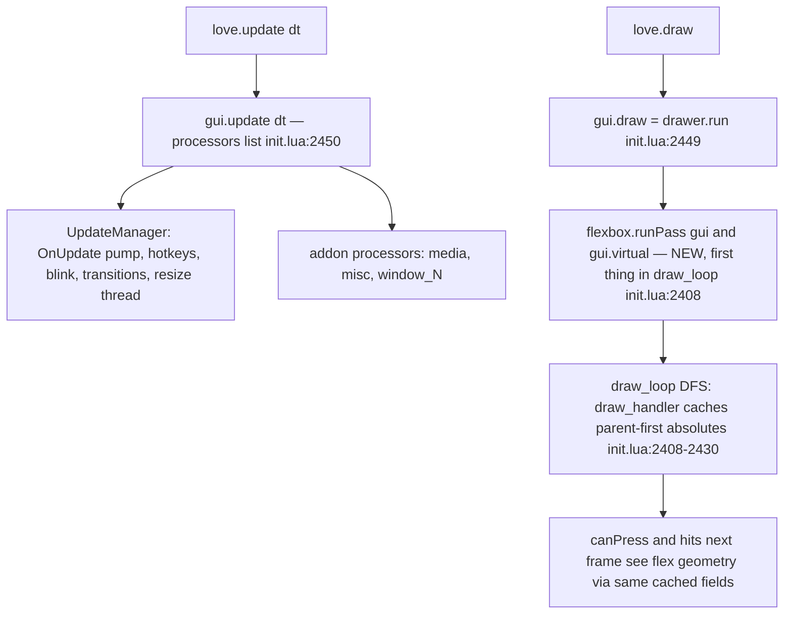
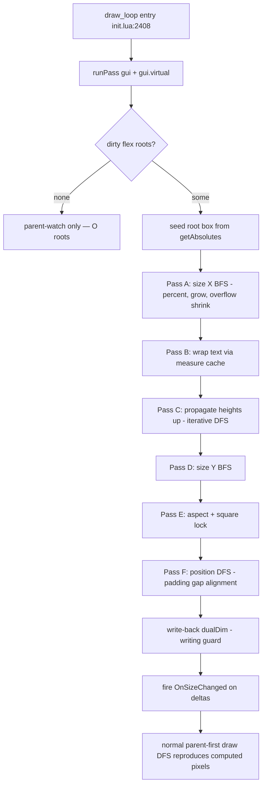

# Flexbox Integration Plan — Scoped Port of Clay v0.14 into the Retained LÖVE GUI Tree

Status: approved strategy, planning only. No Lua implemented yet.
Owner: planning subtask. Target library root: `c:/Users/Ryan/Workspace/jeopardy/gui`.

---

## 0. Ground truth verified by reading the code

Everything below is cited from files actually read during planning.

| Fact | Location |
|---|---|
| `getAbsolutes` closed-form dualDim resolution + `square` lock | [`init.lua:371-391`](../init.lua:371) |
| `setDualDim` fires `OnSizeChanged`; `rawSetDualDim` does not | [`init.lua:412-428`](../init.lua:412) |
| `move`/`size` mutate dualDim slots directly and fire events | [`init.lua:299-309`](../init.lua:299) |
| `newDualDim` = 8-slot table; constructors take the 8-value tail | [`init.lua:1109-1116`](../init.lua:1109), [`init.lua:1069-1107`](../init.lua:1069) |
| `draw_handler` caches `child.x/y/w/h` from `getAbsolutes` per element | [`init.lua:2211-2218`](../init.lua:2211) |
| `clipDescendants` stamps `__clip` on all descendants; scissor applied at draw; `canPress` intersects `__clip` | [`init.lua:2222-2253`](../init.lua:2222), [`init.lua:470-480`](../init.lua:470) |
| `draw_loop` iterates `gui:getAllChildren()` (DFS, parents before children) — this is the parent-first cache refresh | [`init.lua:2408-2430`](../init.lua:2408) |
| Virtual tree geometry refresh every 100 ms via `draw_handler(child, true, 0)` | [`init.lua:2433-2442`](../init.lua:2433) |
| `gui.update` runs `processors` list (UpdateManager first, addons append via `newProcessor`); `gui.draw = drawer.run` | [`init.lua:2444-2460`](../init.lua:2444) |
| Root refresh thread sets `gui.w/h/x/y` and `dualDim.offsetW/H` every frame (incl. letterbox) — mutates fields directly, no `setDualDim` | [`init.lua:2517-2548`](../init.lua:2517) |
| `centerX/centerY` loop rewrites `offsetX/scaleX` continuously (`centerthread`) | [`init.lua:840-870`](../init.lua:840) |
| Text drawn via `love.graphics.printf` into the element box; `centerText` already uses `font:getWrap(text, w*mul)` | [`init.lua:2130-2151`](../init.lua:2130) |
| `calculateFontOffset` canvas pixel-scanning (to be superseded for flex sizing only) | [`init.lua:1156-1198`](../init.lua:1156) |
| `newScrollFrame` fakes scroll with `content:setDualDim(-scrollX, -scrollY)`; `applying` re-entrancy guard | [`addons/system.lua:158-314`](../addons/system.lua:158), guard at [`addons/system.lua:191,229-237`](../addons/system.lua:229) |
| YAML maps `x/y/w/h/sx/sy/sw/sh` onto dualDim tail in `parseDualDim` | [`yaml/builder.lua:29-49`](../yaml/builder.lua:29) |
| Core modules are required as `gui.core.X`; shaders use late `module.init(gui)` injection to dodge circular requires | [`init.lua:1-6`](../init.lua:1), [`init.lua:2558-2562`](../init.lua:2558) |
| Clay sizing enums / layout config (FIT default, GROW, PERCENT, FIXED; padding, childGap, childAlignment) | [`clay.h:299-360`](../reference/clay/clay.h:299) |
| Clay floating config (offset, expand, zIndex, attach points, clipTo) | [`clay.h:484-514`](../reference/clay/clay.h:484) |
| `Clay__SizeContainersAlongAxis`: BFS one axis; percent expansion; iterative shrink-largest-toward-second-largest with `minDimensions`; grow loop with `max`; off-axis stretch/clamp | [`clay.h:2281-2513`](../reference/clay/clay.h:2281) |
| `Clay__CalculateFinalLayout`: X BFS → text wrap (cached word measure, height = lineHeight × lines) → aspect → upward height propagation (iterative DFS) → Y BFS → aspect → zIndex sort → final DFS with padding/gap/alignment/scroll | [`clay.h:2573-3193`](../reference/clay/clay.h:2573) |
| Clay word-by-word text measure cache keyed by (text, fontId, size, letterSpacing) | [`clay.h:1639-1719`](../reference/clay/clay.h:1639) |

**Critical structural insight:** the existing engine's only source of truth is the dualDim table; `draw_handler` re-derives absolutes from it every frame, parent-first. Therefore the flex pass can be a *pure pre-pass that rewrites dualDim values* and every downstream consumer (`draw_handler`, `canPress`, `__clip`, scroll frame, YAML, addons, blur, shaders reading `child.w/h`) keeps working with zero changes. This is the linchpin of the whole design.

---

## 1. File-by-file breakdown

### New files

| File | Purpose |
|---|---|
| `core/flexbox.lua` | The entire flex engine: `setFlex`/`setSizing` API, config storage/validation, dirty flags, the Clay-derived two-pass sizing + position assignment, dualDim write-back, debug verifier. Exposes `flexbox.init(gui, updater, drawer)` following the shader module pattern ([`init.lua:2558-2562`](../init.lua:2558)). |
| `core/measure.lua` | Text measurement service: wraps `love Font:getWidth` / `Font:getHeight` / `Font:getWrap` with a per-(font, text, wrapWidth) cache mirroring Clay's measure cache ([`clay.h:1639`](../reference/clay/clay.h:1639)). Returns `{width, height, lines}`. Cache is a plain Lua table keyed `fontRef .. "\0" .. text .. "\0" .. floor(wrapW)`; generation counter drops stale entries every pass. |
| `examples/flex-demo/main.lua` (+ `conf.lua`) | Standalone LÖVE demo app exercising every feature; doubles as the manual test harness (see §8). |
| `examples/flex-demo/verify.lua` | Invariant checker module loaded by the demo: asserts computed absolutes == `getAbsolutes()` output after write-back; prints `PASS`/`FAIL` lines to console. |
| `docs/flexbox.md` | User-facing docs for `setFlex`/`setSizing`, escape hatch, examples. |

### Existing files edited (minimal, surgical)

| File | Edit | Anchor |
|---|---|---|
| `init.lua` | 1. `local flexbox = require("gui.core.flexbox")` after line 6. | [`init.lua:1-6`](../init.lua:1) |
| `init.lua` | 2. In `setDualDim`, `rawSetDualDim`, `move`, `size`: one-line escape-hatch call `flexbox.onManualGeometry(self)` (no-op unless element is flex-managed and no write guard is active). | [`init.lua:299-309`](../init.lua:299), [`init.lua:412-428`](../init.lua:412) |
| `init.lua` | 3. In `newBase`, after inserting the child: `flexbox.onChildAdded(self, c)`. In `destroy` and `setParent`: `flexbox.onChildRemoved(...)` marks the ex/new parent dirty. | [`init.lua:1089-1096`](../init.lua:1089) |
| `init.lua` | 4. At top of `draw_loop`, before `gui:getAllChildren()`: `flexbox.runPass(gui); flexbox.runPass(gui.virtual)`. | [`init.lua:2408-2410`](../init.lua:2408) |
| `init.lua` | 5. Bottom of file, before `return gui`: `flexbox.init(gui, updater, drawer)` (same injection pattern as shaders). | [`init.lua:2558-2562`](../init.lua:2558) |
| `init.lua` | 6. In the 100 ms virtual-refresh thread, call `flexbox.runPass(gui.virtual)` before the refresh loop (so parked flex subtrees keep correct cached geometry). | [`init.lua:2433-2442`](../init.lua:2433) |
| `yaml/builder.lua` | Optional (Phase 6): in `applyShared`, map `flex:` and `sizing:` YAML tables onto `setFlex`/`setSizing`. No change to `parseDualDim`. | [`yaml/builder.lua:51-153`](../yaml/builder.lua:51) |
| `addons/system.lua` | Optional (Phase 7): `newScrollFrame` gains `content:setFlex{...}` support with size-only management (see §7). | [`addons/system.lua:158-314`](../addons/system.lua:158) |
| `docs/layout-system.md` | Add cross-reference section pointing to `docs/flexbox.md`. | end of file |
| `docs/README.md`, `docs/api-quick-reference.md` | Add entries for `setFlex`/`setSizing`. | — |

**No other file is touched.** `draw_handler`, `canPress`, `getAllChildren`, `centerX/centerY`, `square`, `fullFrame`, blur, transitions, addons, and the YAML dualDim path all remain byte-identical except the six one-line hooks in `init.lua` listed above (each guarded to be a no-op for non-flex elements).

---

## 2. Data model

### 2.1 Config tables stored on elements (all underscore-prefixed, GC-safe, created lazily)

```lua
-- On a container that opted in via frame:setFlex{...}
elem.__flex = {
    direction = "row" | "column",       -- default "row"  (Clay LEFT_TO_RIGHT / TOP_TO_BOTTOM, clay.h:357)
    gap       = 0,                      -- childGap, px (clay.h:355)
    padding   = { l = 0, r = 0, t = 0, b = 0 },  -- (clay.h:341-346)
    alignX    = "start" | "center" | "end",      -- childAlignment.x (clay.h:312-315)
    alignY    = "start" | "center" | "end",      -- childAlignment.y
}

-- On a child of a flex container, via child:setSizing{...}
elem.__sizing = {
    width  = { mode = "fit" | "grow" | "percent" | "fixed", value = nil, min = 0, max = math.huge },
    height = { mode = ..., value = nil, min = 0, max = math.huge },
    aspectRatio = nil,                  -- optional, w/h (Clay aspectRatio, clay.h:415-420)
}
-- Default for any child of a flex container with no explicit setSizing:
-- both axes mode="fit" — matches Clay's CLAY__SIZING_TYPE_FIT default (clay.h:302).

-- Bookkeeping flags
elem.__flexManaged = nil | { size = true, pos = true }  -- geometry owned by the pass
elem.__flexComputed = nil                               -- {x,y,w,h} last computed absolutes
elem.__flexDirty = nil                                  -- container needs re-layout
```

### 2.2 API signatures

```lua
frame:setFlex(opts)        -- opts validated: direction in {row,column}; gap/padding numbers >= 0;
                           -- alignX/alignY in {start,center,end}. Invalid key/value -> error() with
                           -- element type + bad key (library already errors on bad args, e.g. init.lua:443).
frame:setFlex(false)       -- opt out; children keep last written dualDim (never re-touched).
child:setSizing(opts)      -- sets __sizing, re-enables __flexManaged if it was escaped.
                           -- mode="percent" validates 0 <= value <= 1 (clay.h:305 "Expects 0-1 range").
child:setSizing(false)     -- permanently escape: child keeps manual dualDim, excluded from flow.
```

### 2.3 Precise interaction with dualDim (the escape-hatch contract)

1. **A flex-managed child's dualDim is output, not input.** Before the pass computes, the *only* dualDim-derived input the pass reads is the flex **root's** own geometry (a container whose parent is not a `__flex` container). Its dualDim is user-owned exactly as today.
2. **Manual writes escape.** `setDualDim`, `rawSetDualDim`, `move`, `size` on a `__flexManaged` element call `flexbox.onManualGeometry(elem)`, which sets `elem.__flexManaged = nil` and marks the parent container dirty. From then on the child is a **floating child** (§6): it keeps its manual dualDim forever, is excluded from sizing sums and flow offsets, but remains a descendant (clip, draw order, events all unchanged). This is the documented escape hatch and it is the *only* way out besides calling `setSizing` again to re-join.
3. **Write-back is guarded.** The pass writes via `rawSetDualDim` inside a module-local `writing = true` flag; `onManualGeometry` returns immediately while the guard is set. This mirrors the `applying` flag pattern in `newScrollFrame` ([`addons/system.lua:191,229-237`](../addons/system.lua:229)).
4. **Event policy.** After writing, for each managed element whose computed `w/h` differ from `__flexComputed`, fire `OnSizeChanged:Fire(elem, ...)` (guarded so flex-marking doesn't recurse); fire `OnPositionChanged` likewise. Elements whose geometry didn't change fire nothing → transition/scroll handlers stay quiet on steady-state frames.
5. **`centerX/centerY` and `square` on flex-managed children are rejected** at `setFlex`/`setSizing` time only if both are active: `centerthread` ([`init.lua:840-850`](../init.lua:840)) continuously rewrites `offsetX/scaleX`, which would trip the escape hatch every frame. Documented behavior: enabling `centerX/centerY` on a managed child auto-escapes it (via the same `onManualGeometry` hook — the centering loop calls `rawSetDualDim`). `square` is *compatible*: the pass applies the same lock the resolver does (§5.6) so the write-back is idempotent.

### 2.4 Validation & defaults summary

- `setFlex` on a non-frame type is allowed (text containers make no sense but buttons do); no type gating, matching library style.
- Negative padding/gap → clamp to 0 (Clay uses `uint16_t` — non-negative by construction, [`clay.h:341-346`](../reference/clay/clay.h:341)).
- `mode="fixed"` with nil value → treated as `fit`.
- `min > max` → `error()`.
- Elements whose parent is not a flex container ignore `__sizing` entirely (zero cost: the pass never visits them).

---

## 3. Algorithm spec (Lua pseudocode) — port of Clay with retained-tree adaptations

Clay's pipeline ([`clay.h:2573-2714`](../reference/clay/clay.h:2573)) is: size X BFS → wrap text → aspect heights → propagate heights up DFS → size Y BFS → aspect widths → zIndex sort → final DFS. We port steps 1–5 and the final DFS verbatim in structure; zIndex sort is a non-goal (draw order = `children` table order, existing `topStack`/`bottomStack`, [`docs/layout-system.md`](layout-system.md) §9).

### 3.0 Entry point and roots

```lua
-- core/flexbox.lua, module-level reusable buffers (no per-frame allocation)
local bfsBuf, dfsBuf, resizableBuf, visitedFlag = {}, {}, {}, {}

function runPass(root)          -- root = gui or gui.virtual
    for each flexRoot in collectDirtyFlexRoots(root) do   -- see §5
        layoutFlexRoot(flexRoot)
    end
end
```

A **flex root** = element with `__flex` whose parent does not have `__flex` (or is a tree root). Dirty propagation walks up to the nearest flex root (§5.1).

### 3.1 Seed the flex root's own size

The flex root's box is dualDim-owned. Read it against the parent's *cached* absolutes exactly like the resolver:

```lua
rx, ry, rw, rh = flexRoot:getAbsolutes()   -- uses parent.w/h cached last frame, init.lua:371
-- apply square lock here too (init.lua:385)
```

This is the only place the pass consumes the old system; everything below is computed top-down and written back. (Staleness of `parent.w/h` is identical to the staleness every existing consumer already has — §9.)

### 3.2 Pass A — `sizeContainersAlongAxis(axis)` (port of `clay.h:2281-2513`)

```
BFS buffer = {flexRoot}; visited = {}
for i = 1, #bfs do
    parent = bfs[i]
    onAxis = (axis == x and parent.__flex.direction == "row")
          or (axis == y and parent.__flex.direction == "column")
    parentSize   = axis==x and parent.__w or parent.__h      -- scratch fields on the element, not x/y/w/h
    parentPad    = axis==x and (pad.l + pad.r) or (pad.t + pad.b)
    innerContent = 0; totalPadGaps = parentPad; growCount = 0
    resizableBuf = {}

    for child in parent.children where not floating(child) do
        push child containers to bfsBuf (text leaves collected to textBuf instead)  -- clay.h:2349-2353
        s = child.__sizing[axis]
        if s.mode not in {percent, fixed} and not (child is text with wrap=="none") then
            resizableBuf += child                              -- clay.h:2364-2370
        if onAxis then
            innerContent += (s.mode == percent) and 0 or child.__size[axis]
            if s.mode == "grow" then growCount += 1 end
            if not first then innerContent += gap; totalPadGaps += gap end   -- clay.h:2377-2380
        else
            innerContent = max(innerContent, child.__size[axis])             -- clay.h:2382
    end

    -- percent expansion, clay.h:2387-2400
    for child where s.mode == "percent":
        child.__size[axis] = (parentSize - totalPadGaps) * s.value
        if onAxis then innerContent += child.__size[axis] end

    if onAxis then
        free = parentSize - parentPad - innerContent
        if free < 0 then
            -- OVERFLOW SHRINK — clay.h:2405-2445 verbatim:
            if parent clips on this axis then skip end   -- (scroll containers, §7; clay.h:2407-2409)
            while free < -EPS and #resizableBuf > 0:
                largest, secondLargest = topTwoSizes(resizableBuf)
                add = max(secondLargest - largest, free / #resizableBuf)
                for c in resizableBuf where c.__size[axis] == largest:
                    c.__size[axis] += add
                    if c.__size[axis] <= s.min then c.__size = s.min; remove c from buf end
                    free -= (c.__size - previous)
        elseif free > 0 and growCount > 0 then
            -- UNDERFULL GROW — clay.h:2447-2491 verbatim, only mode=="grow" children remain in buf,
            -- smallest-first leveling, capped at s.max.
        end
    else
        -- OFF-AXIS STRETCH/CLAMP — clay.h:2492-2509:
        for c in resizableBuf:
            maxSize = parentSize - parentPad
            if s.mode == "grow" then c.__size[axis] = min(maxSize, s.max) end
            c.__size[axis] = max(s.min, min(c.__size[axis], maxSize))
    end
end
```

Leaf initial sizes (before Pass A): `fit` text → `measure(text, font, wrapW = infinity)` → natural line width, one line (wrapping resolved in Pass B, exactly Clay's order at [`clay.h:2583-2636`](../reference/clay/clay.h:2583)); `fit` image → source image px size; `fit` empty frame → 0; `fixed` → value; `grow`/`percent` → start at fit-minimum (Clay's initial dims, [`clay.h:2322-2327`](../reference/clay/clay.h:2322)).

### 3.3 Pass B — text wrap heights (port of `clay.h:2583-2636` + `1639`)

For each text leaf collected in Pass A, at its now-final width `w`:

```lua
local m = measure.get(child.text, child.font, w)   -- core/measure.lua, cached
-- measure.get replicates love.printf wrapping by calling font:getWrap(text, w):
--   love's own wrap == what printf at init.lua:2146 will render, so measured == rendered.
child.__h = m.lines * child.font:getHeight()       -- clay.h:2635 (lineHeight * #lines)
child.__w = max(child.__w_min, w)                  -- keep shrink results
```

Line height choice: `font:getHeight()` because `love.graphics.printf` line spacing equals that (verified: the library's own `centerText` path computes vertical centering as `h - font:getHeight() * #wrappedLines` at [`init.lua:2139-2141`](../init.lua:2139)). No custom line-height knob in v1.

### 3.4 Pass C — upward height propagation (port of `clay.h:2646-2691`)

Iterative post-order DFS from flexRoot:

```lua
if node.__flex.direction == "row" then
    -- non-layout axis growth: clay.h:2674-2680
    for child: node.__h = clamp(max(child.__h + pad.t + pad.b, node.__h), sizing.height.min, sizing.height.max)
else -- "column"
    -- layout axis: clay.h:2681-2689
    contentH = pad.t + pad.b + sum(child.__h) + gap * max(#children - 1, 0)
    node.__h = clamp(contentH, sizing.height.min, sizing.height.max)
end
```

Only visited when the flex root's own height mode is `fit` (or when it has `fit`-height ancestors up the chain); a `fixed`/`grow`/`percent` root keeps its seeded height and skips re-clamping upward. **This is where Clay's fit-content upward propagation replaces the naive "parent must draw first" dependency**: the pass computes children bottom-up *before* writing anything, so parent-first draw caching never sees fit-content half-states.

### 3.5 Pass D — `sizeContainersAlongAxis("y")`

Identical function as Pass A on the y axis (Clay calls the same function twice, [`clay.h:2581,2694`](../reference/clay/clay.h:2581)).

### 3.6 Pass E — aspect / square (optional knob, port of `clay.h:2638-2643, 2696-2700`)

If `__sizing.aspectRatio` set: `h = w / aspect` after X, `w = h * aspect` after Y. If `elem.square` set: apply the same rule as `getAbsolutes` ([`init.lua:385-389`](../init.lua:385)) — `"w"` → `h = w`, `"h"` → `w = h` — at the very end, **after** position assignment, so the baked dualDim already satisfies the lock and the resolver's re-application is a no-op (idempotence invariant).

### 3.7 Pass F — final position DFS (port of `clay.h:3095-3183`)

Pre-order DFS carrying cursor offsets:

```lua
-- on-axis alignment lead-in, clay.h:3097-3131:
extra = rootSize - pad - totalContentSize
cursorOn = padStart + max(0, alignOn == "center" and extra/2 or alignOn == "end" and extra or 0)

for child in children (table order — existing draw order, no zIndex sort):
    if floating(child) then child keeps its dualDim; continue end   -- §6
    -- cross-axis alignment per child, clay.h:3142-3159:
    cross = padCross
    white = rootCross - padCrossL - padCrossR - child.__size[cross]
    if alignCross == "center" then cross += white/2
    elseif alignCross == "end" then cross += white end
    child.__x = rootX + cursorOn (+0 for first)  -- gap added when advancing, clay.h:3176-3181
    child.__y = rootY + cross
    cursorOn += child.__size[on] + gap
    recurse(child) if child.__flex
end
```

### 3.8 Write-back (see §5 for formulas)

Then `__flexComputed = {x,y,w,h}`, fire guarded events.

---

## 4. Floating / absolute children inside flex containers

Clay models these as "floating elements" with attach points, zIndex, expand ([`clay.h:484-514`](../reference/clay/clay.h:484)). We keep only the minimum that fits the retained model:

- A child becomes **floating** when (a) it escaped via a manual dualDim write (§2.3), or (b) the user declared `setSizing(false)` / `setFlexFlow(false)`.
- Floating children are **excluded from all sizing sums and cursor advancement** in every pass (analog of Clay treating floaters as separate tree roots, [`clay.h:2292-2320`](../reference/clay/clay.h:2292)), but they remain in `parent.children`, so `getAllChildren` draw order, `clipDescendants` scissor stamping ([`init.lua:2222-2236`](../init.lua:2222)), and `canPress` clip intersection ([`init.lua:470-480`](../init.lua:470)) work unchanged — their dualDim resolves against the flex parent's freshly written absolutes like any normal anchored element.
- Positioning stays 100% dualDim-native: the anchoring cookbook ([`docs/layout-system.md`](layout-system.md) §3) remains the tool for placing overlays inside a flex container (e.g. top-right badge = `(-110, 10, 100, 40, 1, 0)`). No attach-point enum, no zIndex (stack order = `topStack`/`bottomStack`), no pointer-capture mode — those are explicit non-goals.
- A floating container (`__flex` on a floating element) still lays out its own children normally.

---

## 5. Dirty-flag + scheduling

### 5.1 Marking rules (`flexbox.markDirty(elem)`)

Walk from `elem` up the parent chain to the nearest flex root, set `__flexDirty` on each flex ancestor, register the flex root in `dirtySet`. Triggered by:

| Trigger | Mechanism |
|---|---|
| `setFlex` / `setSizing` / escape-hatch manual write | direct call in the API / `onManualGeometry` |
| child added | `newBase` hook ([`init.lua:1089-1096`](../init.lua:1089)) — marks `self` dirty if `self.__flex` |
| `destroy()` / `setParent()` | hook marks old/new parent dirty |
| flex container's own dualDim changed | `OnSizeChanged`/`OnPositionChanged` connections installed by `setFlex` (connections auto-cleaned on destroy, [`init.lua:727-731`](../init.lua:727)); guarded so write-back-fired events don't re-mark |
| **non-flex parent resized** | per-frame cheap watch: each flex root caches `(parent.w, parent.h, parent.x, parent.y)` at pass time; at `runPass` start, if changed → dirty. This covers window resize/letterbox without any init.lua resize-thread edit ([`init.lua:2517-2548`](../init.lua:2517) mutates fields directly and fires nothing). |

### 5.2 Where the pass runs in the pipeline



Placing the pass at the top of `draw_loop` (not in UpdateManager) gives three ordering guarantees for free:

1. **After all update logic**: every addon processor in the `processors` list ([`init.lua:2444-2454`](../init.lua:2444)) has finished mutating geometry, and the root-resize thread has already refreshed `gui.w/h/x/y` (it runs inside UpdateManager via `thread.yield()` each frame, [`init.lua:2517-2519`](../init.lua:2517)).
2. **Parent sized before children's pass**: the pass is self-contained per flex root — it reads only the flex root's box (from already-cached parent absolutes) and computes everything else internally (§3.4 breaks the fit-content/parent-first conflict).
3. **Single pass per frame**: one DFS over dirty flex roots only; steady-state cost is O(#flexRoots) parent-watch checks.

The 100 ms virtual-tree refresh thread ([`init.lua:2433-2442`](../init.lua:2433)) gets its own `runPass(gui.virtual)` call so parked flex subtrees keep cached geometry current.

### 5.3 Re-entrancy guards

- `writing` module flag around write-back (mirrors scroll frame's `applying`, [`addons/system.lua:229-237`](../addons/system.lua:229)): prevents `onManualGeometry` escape from the pass's own `rawSetDualDim`, and prevents `markDirty` from the `OnSizeChanged` the pass itself fires.
- `running` flag on `runPass`: if a fired `OnSizeChanged` handler calls back into `setDualDim` on a managed element mid-pass, the escape-hatch flag is set and a re-run is requested for next frame instead of recursing.
- `centerthread` ([`init.lua:844-848`](../init.lua:844)) calls `rawSetDualDim` in a loop → auto-escapes centered children (documented in §2.3; verification recipe in Phase 4).

### 5.4 Interaction with existing layout features

| Feature | Interaction |
|---|---|
| `square` | Compatible — pass applies the identical lock post-positioning (§3.6); resolver re-application at [`init.lua:385`](../init.lua:385) becomes a no-op on managed elements. |
| `centerX/centerY` | Auto-escapes the child (the centering loop writes dualDim every frame). `alignX/alignY="center"` on the container is the flex-native replacement. |
| `fullFrame()` | On a flex root: normal dualDim, works as the root's size seed. On a managed child: escape hatch (it's a `setDualDim` call). |
| `setAspectSize` letterbox | Handled by the parent-watch in §5.1: letterbox changes `gui.w/h/x/y` → all top-level flex roots dirty. |
| `move`/`size` incremental drags on managed elements | Escape hatch by contract — dragging a flex child opts it out; document loudly. |

---

## 6. Write-back math

For every flex-managed element with computed absolutes `(cx, cy, cw, ch)` and parent cached absolutes `(px, py, pw, ph)` — where `px/py/pw/ph` are the *same numbers the resolver will use next draw* (the flex root's parent uses its own cached `parent.x/y/w/h`; nested flex children use values the pass itself computed AND baked into the parent's dualDim, so the values agree by construction):

```lua
rawSetDualDim(elem,
    offsetX = cx - px,   -- x = pw*0 + (cx-px) + px = cx   ✔ (init.lua:380-383 with scales zeroed)
    offsetY = cy - py,
    offsetW = cw,        -- w = pw*0 + cw                ✔
    offsetH = ch,        -- h = ph*0 + ch                ✔
    scaleX = 0, scaleY = 0, scaleW = 0, scaleH = 0)
```

- **No rounding.** Floats reproduce bit-exactly through the resolver; `setScissor`/`printf` accept fractional rects (existing behavior).
- **Invariant check** (the acceptance test for every phase): after write-back, `elem:getAbsolutes()` must equal `(cx, cy, cw, ch)` within 1e-9. `flexbox.debugVerifySubtree(root)` walks the subtree asserting this and prints failures.
- **Letterboxed roots:** `gui.x/y` carry the letterbox offset and `gui.w/h` the inset size ([`init.lua:2521-2535`](../init.lua:2521)); the flex root seed (§3.1) reads them via `getAbsolutes`, and `px/py` for write-back are `gui.x/gui.y` — so computed pixels are already in screen space and the math above is unchanged. `gui.virtual` gets identical values from the same thread ([`init.lua:2530-2535`](../init.lua:2530)).
- **Self-parented roots** (`gui.parent = gui`, [`init.lua:2479`](../init.lua:2479)): never relevant — `gui` itself is never flex-managed; flex roots are its children.
- **`__flexManaged = {size=true, pos=false}` variant (Phase 7, scroll):** write-back touches only `offsetW/offsetH` (scales `scaleW/scaleH = 0`), leaving `offsetX/offsetY` untouched so `newScrollFrame`'s `content:setDualDim(-scrollX, -scrollY)` ([`addons/system.lua:234`](../addons/system.lua:234)) keeps working — but that call would trip the escape hatch on position slots, so the scroll integration must set the managed-mode table accordingly (see §7).

---

## 7. Scroll container integration — OPTIONAL Phase 7

`newScrollFrame` today: viewport `clipDescendants = true`, content width = viewport width, `content:setDualDim(-scrollX,-scrollY)` translates it; scrollbar sizing reads `content:getAbsolutes()` ([`addons/system.lua:158-314`](../addons/system.lua:158)).

Flex benefit: content frame's **height becomes fit-content** (auto maxScrollY from real content) instead of hand-managed `setContentSize` ([`addons/system.lua:296-304`](../addons/system.lua:296)).

Design:
- `content:setFlex{direction="column", gap=..., padding=...}` + internal `__flexManaged = {size=true, pos=false}` on content.
- Flex pass sizes content height (Pass C fit propagation) and writes only `offsetW/offsetH`; scroll's own `setDualDim(-scrollX,-scrollY)` then must be routed through a `flexbox.allowManualPos(content)` pre-arm that suppresses the escape hatch for position slots only (one guard call inside `applyScroll`, 1-line change at [`addons/system.lua:234`](../addons/system.lua:234)).
- Clay's own behavior confirms this composition: scroll containers skip overflow compression on their clipped axis ([`clay.h:2407-2409`](../reference/clay/clay.h:2407)) and grow children to inner-content size on the off axis ([`clay.h:2501-2504`](../reference/clay/clay.h:2501)) — port both rules into Pass A when `parent.clipDescendants` is set.
- Marked optional because `newScrollFrame` already works; risk of regressing it (§9) outweighs convenience for v1.

---

## 8. Phasing — 5 phases + 1 optional, each independently verifiable

No test framework exists anywhere in the repo (verified: no `tests/` outside `reference/clay/tests/docker-compose.yml`). Every phase is verified by (a) running the standalone demo app with `love examples/flex-demo` and reading console output, and (b) the dualDim write-back invariant: `getAbsolutes() == __flexComputed` for every managed element after every pass, asserted by `verify.lua` each frame (`gui.update`'s OnUpdate handler calls `flexbox.debugVerifySubtree` when `FLEX_VERIFY=1`).

### Phase 1 — Measure service
- **Scope:** `core/measure.lua` (cached `getWidth/getHeight/getWrap` wrapper, generation sweep); unit-ish demo printing measured wrap lines vs `love.graphics.printf`-rendered layout.
- **Files:** new `core/measure.lua`, new `examples/flex-demo/main.lua` skeleton, `conf.lua`.
- **Acceptance:** measure cache hits ≥ 1 lookup per (font,text,width) per frame; wrap line count from `font:getWrap` equals lines visibly rendered by `printf` at same width (visual check + printed count).
- **Verify:** `love examples/flex-demo` → printed table `text | measured lines | visible lines` all match; second frame cache stats show hits.

### Phase 2 — Core flex engine + write-back (frames only, no text sizing)
- **Scope:** `core/flexbox.lua`: `setFlex`/`setSizing` API + validation, config tables, dirty marking, Pass A/D (fixed/grow/percent/min/max), Pass F positions, write-back + `writing` guard, `runPass` at draw_loop top; init.lua hooks (items 1,2,4,5 of §1).
- **Files:** new `core/flexbox.lua`, `examples/flex-demo/verify.lua`; edits to `init.lua` (lines ~6, ~300, ~306, ~413, ~418, ~1095, ~2409, ~2562).
- **Acceptance:** row/column demos with fixed+percent+grow children render at expected pixel rects; overflow demo (three 200px fixed children in 400px row, two with `min=60`) shrinks to exactly the Clay rule (children clamp at min, third clamps at min too → overflow past container, matching `clay.h:2405-2445`); `setDualDim` on a managed child escapes it permanently.
- **Verify:** demo prints each child's expected vs `getAbsolutes()` actual (tolerance 1e-9) → all PASS; verify.lua frame-loop prints `INVARIANT OK` / list of mismatches; manual: drag a managed child (it escapes and stays where dropped).

### Phase 3 — Text fit-content sizing + height propagation
- **Scope:** leaf seeding from `core/measure.lua`, Pass B wrap heights, Pass C upward propagation, Pass E `square` idempotence; text elements as flex children (labels/buttons).
- **Files:** `core/flexbox.lua`, demo.
- **Acceptance:** label with `width=fit` in a column sizes to longest line; label with `width=percent(0.5)` in a row wraps to N lines and the column's fit-height grows by exactly `N * font:getHeight()`; `square="w"` on a managed frame keeps w==h through resize.
- **Verify:** demo screen "wrapping": shrink window → watch line count and parent height numbers printed each resize; compare to visible text (no clipping, no blank gap); height formula check: `parentH == pad.t+pad.b+ΣchildH+gap*(n-1)` printed PASS.

### Phase 4 — Alignment, gap, padding, off-axis stretch, floating children
- **Scope:** `alignX/alignY` (start/center/end incl. on-axis lead-in, `clay.h:3097-3131`), off-axis grow/stretch/clamp (`clay.h:2492-2509`), escape hatch completion (`move`/`size` hooks, `setSizing(false)`), floating children semantics.
- **Files:** `core/flexbox.lua`, `init.lua` (remaining `move`/`size` hooks if not done in P2), demo.
- **Acceptance:** toolbar demo (row, `alignY="center"`, gap 8, padding 12) pixel-matches hand-computed offsets; badge child with manual dualDim inside the toolbar doesn't shift siblings; `centerX` child auto-escapes (verify flag flips).
- **Verify:** demo overlay draws 1px debug rects from `__flexComputed`; visually compare to hand-calc table in the demo's printed expected list; floating badge survives container resize still anchored bottom-right via its dualDim.

### Phase 5 — Dirty-flag optimization, events, virtual tree, docs
- **Scope:** parent-watch (§5.1), `OnSizeChanged`/`OnPositionChanged` firing policy, `running` re-entrancy guard, `runPass(gui.virtual)` in refresh thread + draw_loop, `docs/flexbox.md`, `docs/layout-system.md` cross-ref, `docs/api-quick-reference.md` entries.
- **Files:** `core/flexbox.lua`, `init.lua` (hook at 2433), docs.
- **Acceptance:** steady-state frame does zero layout work (perf probe `core/probe.lua` shows no new per-frame allocations; add a counter `flexbox.stats.passes/elementsVisited` printed by demo); parked (virtual) flex window still has correct cached absolutes after 100 ms refresh; window resize + `setAspectSize` letterbox reflows flex roots correctly.
- **Verify:** demo prints stats each frame: `visited == 0` when idle, `> 0` only after interaction; resize while holding `Ctrl` demoed manually; scroll-frame-using app (`addons` demo surface) unchanged pixel-for-pixel (regression smoke: existing windows/menus still work — manual pass through whatever app hosts this library).

### Phase 6 — OPTIONAL: scroll + YAML
- **Scope:** §7 scroll integration behind one `applyScroll` guard line; `yaml/builder.lua` `flex:`/`sizing:` keys; demo screen with scrollable flex content.
- **Files:** `addons/system.lua` (≤3 lines), `yaml/builder.lua` (~20 lines), `docs/yaml-declarative-ui.md`, demo.
- **Acceptance:** scroll demo's `maxScrollY` derives from fit-content height with no `setContentSize` call; YAML `{flex: {direction: column, gap: 4}, sizing: {height: fit}}` builds an equivalent tree to the imperative one.
- **Verify:** thumb size/position math in `updateScrollbars` reacts to content auto-height (print `maxScrollY` before/after adding a child); YAML equivalence: build both trees, assert identical `getDualDim` tails.

---

## 9. Risks & mitigations

| Risk | Evidence | Mitigation |
|---|---|---|
| **GC/perf churn on large trees** (Lua allocates; Clay uses arenas) | BFS/DFS buffers would allocate every pass | Module-level reusable buffers (§3.0), `__flexDirty` gating means idle frames visit 0 elements; `measure.lua` cache with generation sweep (analogue of Clay's generation eviction, `clay.h:1664-1667`); demo prints visited-count as the perf gate. |
| **`OnSizeChanged` re-entrancy** — handlers that call `setDualDim` mid-pass (scroll frame does exactly this pattern) | [`addons/system.lua:264-278`](../addons/system.lua:264) | `writing`/`running` guards (§5.3) modeled on the proven `applying` flag; deferred re-run next frame; event fired only on actual delta. |
| **Fit-content upward propagation vs parent-first draw caching** — resolver assumes parent drawn first | [`init.lua:2215-2218`](../init.lua:2215), [`docs/architecture.md`](architecture.md) §4 | Pass computes children *before* parent's final numbers exist (Pass C bottom-up), then bakes everything down in one write-back; only the flex root consumes one-frame-stale parent size — identical staleness to every existing consumer, and the parent-watch dirty flag closes the resize case. |
| **Text measure accuracy vs `printf`** — measured wrap ≠ rendered wrap | draw uses `printf` at `w*mul` (circle/arc ×2, [`init.lua:2131-2134`](../init.lua:2131)); `adjust`/`textOffsetX` inset the print box | `measure.lua` wraps the *same* `font:getWrap` LÖVE uses internally, and the measure width applies the same `mul` and `adjust` inset rules as the draw path; Phase 1 acceptance is literally "measured lines == visible lines". |
| **Transitions/shaders/blur read absolutes during animation** — a glide animating a managed element's dualDim fights the pass | `blur_draw` recomputes `getAbsolutes` ([`init.lua:2329-2333`](../init.lua:2329)); shaders get `size`/`position` uniforms from cached values ([`init.lua:2238-2246`](../init.lua:2238)) | Because write-back keeps dualDim truthful, blur/shader/`canPress` all see flex geometry for free. For animations: any external `setDualDim` on a managed element auto-escapes it (documented), so a transition animating a flex child turns it floating rather than oscillating. Explicitly unsupported in v1: animating *container size* while flex reflows it (documented caveat). |
| **`centerX/centerY` loops silently escape children** | [`init.lua:844-848`](../init.lua:844) | Documented + demoed (Phase 4); flex `alignX/alignY` is the replacement; consider warning print once per element. |
| **Dragged windows / addons that `setDualDim`** (e.g. window move) would escape flex children | `newWindow` uses dualDim math ([`addons/system.lua:441+`](../addons/system.lua:441)) | Escape hatch semantics make this *correct* behavior (dragging implies manual control); non-flex subtrees untouched 100%. |
| **Virtual-tree staleness** — parked flex subtree misses the draw_loop pass | [`init.lua:2433-2442`](../init.lua:2433) | `runPass(gui.virtual)` added to that thread (Phase 5). |
| **Letterbox/resize thread mutates fields without events** | [`init.lua:2525-2545`](../init.lua:2525) | Per-flex-root parent watch (§5.1) — no event needed. |

---

## 10. Explicit non-goals

- **No grid layout** (Clay v0.14 has none — verified).
- **No immediate-mode API**; the retained element tree is the only input.
- **No arena allocator / manual memory**; plain Lua tables + reusable buffers.
- **No element ID hashing / `Clay_GetPointerOverIds`-style identity**; the tree's object identity suffices.
- **No C FFI / LuaJIT cffi port** of clay.h; Lua-idiomatic reimplementation only.
- **No zIndex property**; stacking stays `children` order + `topStack`/`bottomStack`.
- **No attach-point system, pointer-capture modes, or `expand`** from Clay floating config.
- **No changes to `draw_handler`, `canPress`, `getAllChildren`, YAML dualDim parsing, or any addon widget** beyond the six guarded init.lua hooks and (optional) 3 scroll lines.
- **No replacement of `calculateFontOffset`** pixel-scanning for legacy text metrics — the measure hook is used *only* by the flex pass.

---

## Appendix A — Flex pass pipeline (mermaid)



## Appendix B — Clay → flexbox symbol map

| Clay ([clay.h](../reference/clay/clay.h)) | Port location |
|---|---|
| `Clay__SizeContainersAlongAxis` (2281) | `sizeContainersAlongAxis(axis)` in `core/flexbox.lua`, Pass A/D |
| shrink-largest loop (2411-2445) | same function, overflow branch |
| grow-smallest loop (2455-2490) | same function, underfull branch |
| off-axis stretch (2492-2509) | same function, else branch |
| text wrap + `MeasureTextCached` (2583-2636, 1639) | Pass B + `core/measure.lua` |
| height propagation DFS (2646-2691) | Pass C |
| aspect scale (2638-2643, 2696-2700) | Pass E (partial: aspectRatio + square) |
| final position DFS (2716-3183) | Pass F (minus zIndex sort, scroll offsets, borders) |
| floating config (484-514) | reduced to floating/escape-hatch semantics (§4) |
| `Clay_SizingAxis` union (325-331) | `__sizing[axis] = {mode, value, min, max}` |
