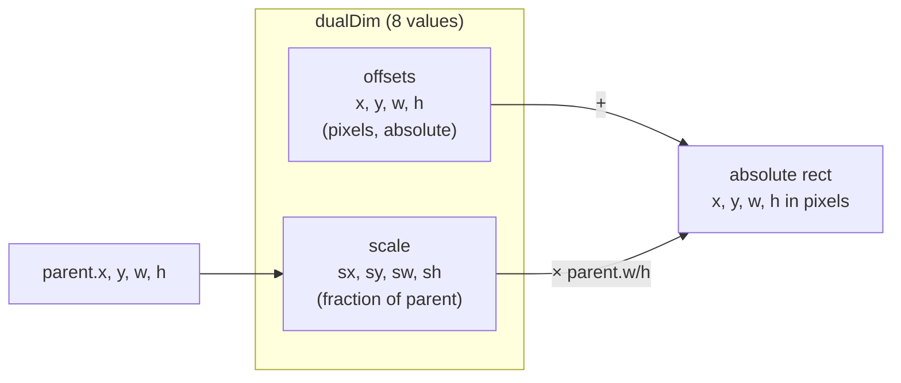
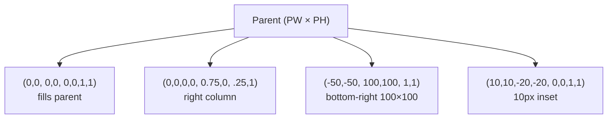

# The Dual-Dimension Layout System

Every element's position and size are described by **eight numbers**: four pixel *offsets*
and four fractional *scale* values relative to the parent. This single mechanism handles
fixed sizes, fluid percentages, anchoring, padding, centering, and responsive scaling —
with no separate layout engine.

Reference: `gui:newDualDim` / `setDualDim` / `getAbsolutes` in
[`init.lua` L1109–1122](../init.lua:1109), [L371–391](../init.lua:371).

---

## Table of Contents

1. [The eight numbers](#1-the-eight-numbers)
2. [The resolution formula](#2-the-resolution-formula)
3. [Anchoring cookbook](#3-anchoring-cookbook)
4. [Reading and writing geometry](#4-reading-and-writing-geometry)
5. [Incremental changes: move / size](#5-incremental-changes-move--size)
6. [Centering](#6-centering)
7. [Square locking](#7-square-locking)
8. [Aspect ratio & letterboxing](#8-aspect-ratio--letterboxing)
9. [Draw order & stacking](#9-draw-order--stacking)
10. [Clipping](#10-clipping)

---

## 1. The eight numbers

```lua
parent:newFrame(x, y, w, h, sx, sy, sw, sh)
--                └─ offsets (px) ─┘  └──── scale (0–1 of parent) ────┘
```

| Slot | Field | Meaning |
|------|-------|---------|
| `x`  | `offsetX` | pixel offset from the parent's left edge |
| `y`  | `offsetY` | pixel offset from the parent's top edge |
| `w`  | `offsetW` | pixel width (can be negative → shrink from full scale) |
| `h`  | `offsetH` | pixel height |
| `sx` | `scaleX`  | fractional X position: `0` = parent's left edge, `1` = right edge |
| `sy` | `scaleY`  | fractional Y position |
| `sw` | `scaleW`  | fractional width: `1` = 100 % of parent width |
| `sh` | `scaleH`  | fractional height |

All eight default to `0` when omitted (`newDualDim`), so a bare `newFrame()` is a
zero-sized rectangle at the parent's origin.

---

## 2. The resolution formula

`getAbsolutes()` resolves the dualDim against the **parent's cached absolutes**
(`parent.x/y/w/h`, refreshed during drawing):

```
absolute_x = parent.w * sx + offsetX + parent.x
absolute_y = parent.h * sy + offsetY + parent.y
absolute_w = parent.w * sw + offsetW
absolute_h = parent.h * sh + offsetH
```

Because offsets and scales **add**, the two channels compose:



### Worked example

```lua
-- 20 % inset sidebar, full height, with 6 px extra padding on the left:
panel:setDualDim(6, 0, 0, 0,   0.2, 0, 0.6, 1)
-- x = 0.2*PW + 6       (starts 20% into the parent, +6px)
-- w = 0.6*PW           (60% of parent width)
```

---

## 3. Anchoring cookbook

| Goal | dualDim call |
|------|--------------|
| Fill parent | `fullFrame()` ≡ `(0,0,0,0, 0,0,1,1)` |
| Fixed box at 10,10 | `(10, 10, 200, 50)` |
| Inset 10 px on all sides | `(10, 10, -20, -20, 0, 0, 1, 1)` |
| Top-right, fixed 100×40 | `(-110, 10, 100, 40, 1, 0)` |
| Bottom-right, fixed | `(-110, -50, 100, 40, 1, 1)` |
| Bottom strip, 15 % height | `(0, 0, 0, 0, 0, 0.85, 1, 0.15)` |
| Horizontal band 30 % tall, centered vertically | `(0, 0, 0, 0, 0, 0.35, 1, 0.3)` |
| Centered fixed-width card (300 px) | `(-150, 0, 300, 0, 0.5, 0.1, 0, 0)` |
| Right 25 % column full height | `(0, 0, 0, 0, 0.75, 0, 0.25, 1)` |

> **Centering trick:** `sx = 0.5` puts the *left edge* at the parent's midpoint; adding
> `offsetX = -w/2` re-centers the box. For automatic centering use `centerX(true)` (§6).



---

## 4. Reading and writing geometry

```lua
-- Resolved pixels:
local x, y, w, h = obj:getAbsolutes()

-- Raw dualDim (8 values):
local x, y, w, h, sx, sy, sw, sh = obj:getDualDim()

-- Write (fires OnSizeChanged):
obj:setDualDim(x, y, w, h, sx, sy, sw, sh)
-- nil keeps the current value of that slot:
obj:setDualDim(nil, nil, nil, 40)     -- set only pixel height

-- Write without firing OnSizeChanged:
obj:rawSetDualDim(...)
```

Internally `setDualDim` replaces the whole dualDim table, merging `nil`s with the previous
values ([`rawSetDualDim`, init.lua L417–428](../init.lua:417)).

```lua
-- Cached absolutes are also available on every element after its draw pass:
print(obj.x, obj.y, obj.w, obj.h)   -- used by parents/children in layout math
```

> **Order matters:** a parent's cached `w/h` is refreshed when it is drawn (or by the
> 100 ms virtual-tree refresh). If you re-layout and immediately query a *child's*
> absolutes in the same frame, force the update first with
> `parent:getAbsolutes()`… or design handlers to react to `OnSizeChanged`.

### Bounds-constrained movement

```lua
obj:moveInBounds(dx, dy)   -- moves only while staying inside the parent
```

### Intersection

```lua
local ix, iy, iw, ih = obj:intersecpt(x, y, w, h)  -- note the spelling
-- overlapping rect in screen space, or 0,0,0,0 if disjoint
```

---

## 5. Incremental changes: move / size

```lua
obj:move(dx, dy)   -- offsetX += dx, offsetY += dy; fires OnPositionChanged
obj:size(dx, dy)   -- offsetW += dx, offsetH += dy; fires OnSizeChanged
```

These are the preferred way to implement dragging:

```lua
btn:enableDragging(gui.MOUSE_PRIMARY)
btn:OnDragging(function(self, dx, dy) self:move(dx, dy) end)
```

---

## 6. Centering

`centerX(true)` / `centerY(true)` keep an element centered within its parent *as layout
changes* — a dedicated centering loop re-applies it continuously, and it is cleaned up on
`destroy()` ([`init.lua` L840–870](../init.lua:840)):

```lua
icon:centerX(true)
icon:centerY(true)
icon:centerX(false)   -- stop centering
```

Mechanism: on each `OnSizeChanged`/`OnPositionChanged` (plus a per-frame loop), it sets
`offsetX = -w/2, scaleX = 0.5` (and analogously for Y).

---

## 7. Square locking

```lua
obj.square = "w"   -- force height := width (width drives)
obj.square = "h"   -- force width := height
```

Applied inside `getAbsolutes` after resolution ([`init.lua` L385–389](../init.lua:385)).
Great for circular avatars, icon buttons, and the video player's square play button
(`play_pause.square = "h"` in [`extensions.lua` L42](../addons/extensions.lua:42)).

---

## 8. Aspect ratio & letterboxing

To design for a fixed virtual resolution and letterbox on odd window shapes:

```lua
gui:setAspectSize(1920, 1080)
gui.aspect_ratio = true
```

The resize-sync thread then sizes the roots to the largest 16:9 area fitting the window and
sets `gui.x/gui.y` to the letterbox offset ([`init.lua` L2492–2548](../init.lua:2492)).
Because every child resolves against the root's `w/h`, the whole tree scales uniformly.
`GetAdjustedToAspectRatio` returns `w, h, xOffset, yOffset` if you need the numbers.

---

## 9. Draw order & stacking

Children are drawn in table order: **last child on top**.

```lua
obj:topStack()     -- move to end of parent.children (front)
obj:bottomStack()  -- move to index 1 (back)
```

Used internally to raise dragged windows and to implement the task manager's overlay.

---

## 10. Clipping

```lua
container.clipDescendants = true
```

When set, `draw_handler` stamps a `__clip` rectangle (the container's absolutes) onto every
descendant each frame; rendering is scissored and **hit tests shrink to the clip region**
(`canPress` intersects with `__clip`) ([`init.lua` L2222–2236](../init.lua:2222),
[L2248–2253](../init.lua:2248), [L470–480](../init.lua:470)). This is what makes
`newScrollFrame` and text areas behave.

Partial-corner clipping variant: `obj:setRoundness(rx, ry, seg, "top"|"bottom")` also
installs a scissor box around the element to fake top/bottom-only rounded corners.
