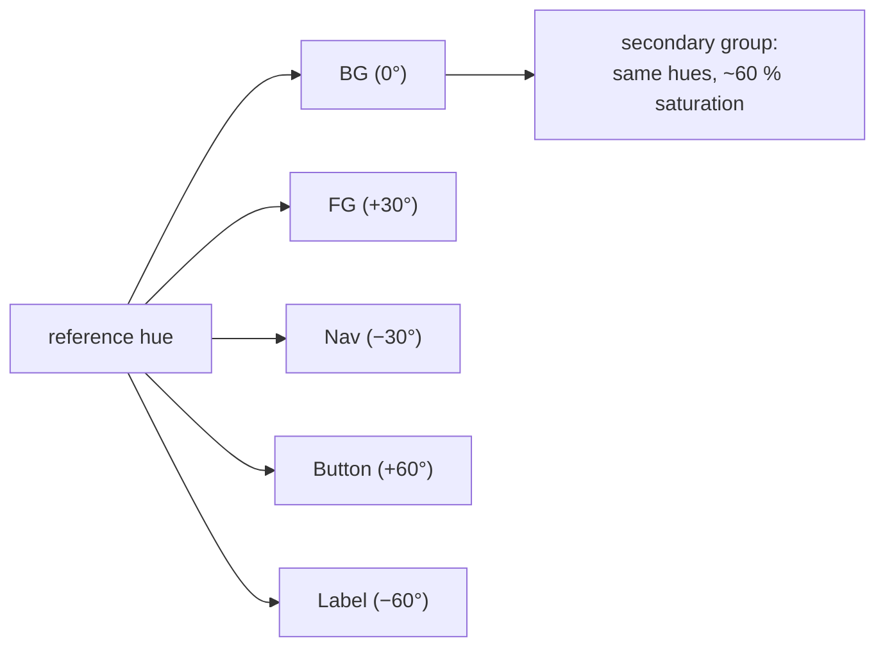

# Theming & Color

Two core modules power the library's visual identity:

- [`gui/core/color.lua`](../core/color.lua) — color parsing, arithmetic, conversion, and
  named palettes (~1,000 names + `gray0`–`gray255`).
- [`gui/core/theme.lua`](../core/theme.lua) — a generated 12-slot palette plus 12 curated
  presets.

> ⚠️ The theming module was recently rewritten around a hue-wheel generator. The current
> API is `newTheme`/presets/`getTheme`/`setTheme` — older docs describing `theme:new{...}`,
> `theme:random()`, `t:dump()` no longer match the code, and some add-ons still reference
> the legacy shape. See [§4.4](#44-legacy-shape-in-add-ons).

---

## Table of Contents

1. [The color module](#1-the-color-module)
2. [Color objects & arithmetic](#2-color-objects--arithmetic)
3. [Palettes & named colors](#3-palettes--named-colors)
4. [The theme module](#4-the-theme-module)
5. [Presets](#5-presets)
6. [Conversion & queries](#6-conversion--queries)

---

## 1. The color module

```lua
local color = require("gui.core.color")
```

All GUI colors are `{r, g, b[, a]}` tables in the **0–1** range (LÖVE convention).

### Accepted input formats for `color.new` / parsing

```lua
color.new("#ff5500")             -- hex (with or without #; 6 or 8 digits)
color.new("#ff550088")           -- hex with alpha
color.new("rgb(255,85,0)")       -- CSS-like, 0-255
color.new("rgba(255,85,0,0.5)")
color.new("hsl(20,100,50)")      -- h 0-360, s/l 0-100
color.new("hsla(20,100,50,0.8)")
color.new("oklab(0.7,0.15,-0.1)")  -- Oklab: L 0-1, a/b ≈ -0.4..0.4 (negatives allowed)
color.new("oklch(0.7,0.15,145)")   -- Oklch: L 0-1, C ≈ 0..0.4, h degrees
color.new("rgb01(1,0.33,0)")     -- 0-1 floats in a string
color.new(1, 0.33, 0)            -- raw floats
color.new({0.2, 0.4, 0.8})       -- table
```

Constructors:

| Function | Returns |
|---|---|
| `color.new(r[,g,b,a])` | color object (metatable-enabled) |
| `color.hsl(h, s, l[, a])` | `r,g,b,a` floats (h 0–360, s/l 0–100) |
| `color.hsv(h, s, v)` | `r,g,b,1` (h 0–360, s/v 0–1) |
| `color.oklab(L, a, b)` | `r,g,b` floats 0–1, clamped to sRGB (L 0–1, a/b ≈ −0.4–0.4) |
| `color.oklch(L, C, h)` | `r,g,b` floats 0–1, clamped — polar Oklab (C ≈ 0–0.4, h degrees) |
| `color.setV3(bool)` | global switch: parse/store colors as 3-components instead of 4 |

> **Hue frame quirk:** `color.hsl` assigns green/blue hues in a mirrored frame relative to
> the standard convention. `color.rgbToHsl` deliberately returns hues in *that same frame*,
> so `rgbToHsl(color.hsl(h,s,l)) == h` round-trips. Keep hue math inside this library's
> frame and it's consistent.
>
> **Oklch is the exception:** the Oklab/Oklch functions ([§6.2](#62-oklab--oklch)) use the
> *standard* hue wheel (red ≈ 29°, green ≈ 142°, blue ≈ 264°), not this mirrored frame.
> Don't mix Oklch hues with `color.hueShift` output.

---

## 2. Color objects & arithmetic

`color.new` results carry an operator metatable:

```lua
local a, b = color.new("#ff0000"), color.new("#00ff00")
(a + b)   -- component-wise +, -, *, /, %, ^, unary -
(a == b)  -- equality on r,g,b
(a < b)   -- component-wise less-than (and <=)
print(a)  -- "name: (1,0,0,1)" if the color is palette-indexed
```

Manipulation:

```lua
color.lighten(c, v)   -- mix toward white by v (0–1)
color.darken(c, v)    -- scale toward black by v (0–1)
color.hueShift(c, dh[, s, l])  -- rotate hue by dh degrees; optional S/L override (0–100)
```

Assignment into elements accepts color objects or plain tables equally:

```lua
frame.color = color.new("#70bfc2")
frame.borderColor = {0, 0, 0}
```

---

## 3. Palettes & named colors

A **palette** is a lookup table of named colors. `indexColor` stores each name in four
casing variants (exact, lower, UPPER, Capitalized):

```lua
local palette = color.newPalette("mygame")
palette:indexColor("accent", "#30C5FF")

palette.accent      -- color object
palette.ACCENT      -- same object
palette.Accent      -- same object
palette.accent.name -- "accent"
palette:listColors()      -- ⚠ currently iterates the array part → empty;
                          --   use `palette.colors` for the list of names
palette:reindexColor("accent", "#ff8800")   -- mutate in place (objects are shared!)
```

Because elements hold *references* to palette colors, `reindexColor` retroactively restyles
everything using that color — the live-theme trick used by the color picker
(`palette:reindexColor("preview", r, g, b)` in [`extensions.lua` L531](../addons/extensions.lua:531)).

The built-in mega-palette (CSS/X11 names + color-name-dataset names + `gray0..255`):

```lua
local base = color.getDefaultPalette()   -- palette under key "$gui.core.color"
frame.color = base.WHITE
label.textColor = base.highlighter_blue  -- #30C5FF, the library's selection color
```

`color.getPalette(name)` retrieves any palette by its registration key. The core registers
`"$gui.core.init"` (white/black/highlighter-blue) and the theme module registers
`"$gui.core.theme"`.

---

## 4. The theme module

```lua
local theme = require("gui.core.theme")
```

### 4.1 The slot model

A theme is a palette with twelve color slots + two text colors, generated from **one
reference color** by hue-wheel offsets
([`THEME_SLOTS`, theme.lua L28–39](../core/theme.lua:28)):



| Slot | Hue offset | Typical use |
|---|---|---|
| `primaryBG` | 0° | main background |
| `primaryFG` | +30° | foreground panels |
| `primaryNav` | −30° | nav/headers |
| `primaryButton` | +60° | buttons |
| `primaryLabel` | −60° | labels/inputs |
| `secondary*` | same offsets, lower saturation | subdued variants |
| `primaryText` / `secondaryText` | — | auto-contrast (black/white by background lightness) |

### 4.2 Generating a theme

```lua
local t = theme:newTheme("#70bfc2", {
    saturation          = 40,    -- primary group S (0-100), default: reference's own
    secondarySaturation = 24,    -- default: 60 % of primary
    lightness           = 60,    -- background L (0-100)
    primaryText         = nil,   -- override contrast text
    secondaryText       = nil,
    darkText            = nil,   -- force dark text; auto-detected when omitted
    apply               = false, -- true = also write into the live palette (setTheme)
})
-- t.primaryBG, t.primaryFG, ..., t.primaryText are color objects
-- t.reference is the parsed reference color
```

Any parseable color works as the reference (`"#hex"`, `"hsl(...)"`, table, etc.).

### 4.3 The live palette

`theme:getTheme()` returns the shared palette (`"$gui.core.theme"`) that core add-on
widgets read at construction. `theme:setTheme(t)` copies a generated theme *into* that
palette via `reindexColor`, so widgets holding references update live:

```lua
local th = theme:newTheme("#2d6a9f", {apply = true})   -- swap the whole app's colors
-- or:
theme:setTheme(theme.midnight())                        -- apply a preset later
```

### 4.4 Legacy shape in add-ons

`newWindow` (in [`addons/system.lua`](../addons/system.lua:545)) expects a table with
fields:

```
colorPrimary, colorPrimaryDark, colorPrimaryText,
colorButtonNormal, colorButtonHighlight, colorButtonText,
fontPrimary, fontButton
```

while `addons/system.lua:6` and `extensions.lua:21` construct themes with the *older*
`{primary, primaryDark, primaryText}` shape via `theme:new(...)` — a constructor the
current theme module does not define. Practical guidance today:

- Build window themes as a **plain table** matching the `colorPrimary…` field list above
  (that's what `window:setTheme` reads), e.g.:

  ```lua
  local winTheme = {
      colorPrimary         = color.new("#124559"),
      colorPrimaryDark     = color.new("#01161e"),
      colorPrimaryText     = color.new("#aec3b0"),
      colorButtonNormal    = color.new("#1e6f8a"),
      colorButtonHighlight = color.new("#2a9bbf"),
      colorButtonText      = color.new("#ffffff"),
      fontPrimary          = love.graphics.newFont(14),
      fontButton           = love.graphics.newFont(14),
  }
  ```

- Or map a generated theme onto that shape:

  ```lua
  local g = theme:newTheme("#16202e")
  local winTheme = {
      colorPrimary     = g.primaryBG,
      colorPrimaryDark = g.primaryNav,
      colorPrimaryText = g.primaryText,
      colorButtonNormal    = g.primaryButton,
      colorButtonHighlight = color.lighten(g.primaryButton, 0.15),
      colorButtonText      = g.primaryText,
  }
  ```

(Adding a `theme:new` alias / shape adapter would close this gap — flagged in
[`gui/fixes.md`](../fixes.md) territory.)

---

## 5. Presets

Twelve curated presets, each a thin wrapper over `newTheme` with tuned S/L
([`theme.lua` L84–259](../core/theme.lua:84)). Every preset accepts the same `opts`
overrides (`saturation`, `secondarySaturation`, `lightness`, `reference`,
`primaryText`, `secondaryText`, `apply`).

| Preset | Mood | Reference |
|---|---|---|
| `obsidian` | near-black blue glass | `#1c1c24` |
| `midnight` | deep navy | `#16202e` |
| `abyss` | dark ocean teal | `#0f2430` |
| `forest` | woodland green | `#17251c` |
| `amethyst` | dark violet jewel | `#221830` |
| `ember` | forge warmth | `#2b1712` |
| `mocha` | coffee brown | `#241c15` |
| `synthwave` | neon on near-black | `#1e1226` |
| `parchment` | warm paper (light) | `#efe6d2` |
| `arctic` | icy pale (light) | `#d9e6ef` |
| `blush` | rose pastel (light) | `#f2dbe2` |
| `mint` | pale green (light) | `#d9eede` |

```lua
theme:midnight({apply = true})          -- swap the live palette

for name, preset in pairs(theme.presets) do     -- build a settings picker
    menu:newTextButton(name)
end
theme.presets.synthwave({apply = true})
```

---

## 6. Conversion & queries

### 6.1 HSL & utility queries

```lua
color.rgbToHex(c)                 -- "rrggbb" (no #)
color.rgbToHsl(c)                 -- h (library hue frame), s 0-100, l 0-100
color.isLight(c)                  -- avg lightness >= 0.5
color.getAverageLightness(c)      -- (r+g+b)/3 in 0-1
```

These feed the theme generator's contrast logic — e.g. `newTheme` picks black vs. white
text by `getAverageLightness(primaryBG) >= .5`
([`theme.lua` L66–72](../core/theme.lua:66)).

### 6.2 Oklab & Oklch

[Oklab](https://bottosson.github.io/posts/oklab/) is a **perceptually uniform** space
([`color.lua` L206–264](../core/color.lua:206)): equal numeric steps look like equal
steps to the eye. That makes it the right tool for gradients, gray ramps, and theme
palettes — HSL ramps visibly bunch/brighten at the mid-tones, Oklab ones don't.

| Function | Returns |
|---|---|
| `color.oklab(L, a, b)` | `r,g,b` floats 0–1 (clamped to sRGB); L 0–1, a/b ≈ −0.4–0.4 |
| `color.oklch(L, C, h)` | `r,g,b` floats 0–1 (clamped); L 0–1, C ≈ 0–0.4, h degrees |
| `color.rgbToOklab(c)` | `L` 0–1, `a`, `b` — accepts any parseable color |
| `color.rgbToOklch(c)` | `L` 0–1, `C`, `h` 0–360 (standard wheel) |

Reference points (sRGB primaries in Oklch): red `0.63, 0.26, 29°` · green `0.87, 0.29,
142°` · blue `0.45, 0.31, 264°` · white `L = 1` · black `L = 0`.

```lua
-- Declare colors in Oklab / Oklch (string forms parse like any other color)
frame.color     = color.new("oklab(0.72,-0.14,-0.09)")   -- muted teal
palette:indexColor("accent", "oklch(0.75,0.18,250)")     -- via the palette API

-- Function forms return r,g,b floats you can feed to color.new or love.graphics
local r, g, b = color.oklch(0.62, 0.22, 29)              -- a vivid red
local swatch  = color.new(r, g, b)

-- Perceptually even gray ramp: HSL would bias mid-steps, Oklab doesn't
local ramp = {}
for i = 0, 10 do
    ramp[i + 1] = color.new(color.oklab(0.1 + 0.8 * i / 10, 0, 0))
end

-- Hue rotation at constant perceived lightness & chroma (STANDARD wheel,
-- unlike color.hueShift's mirrored HSL frame)
for h = 0, 300, 60 do
    local r, g, b = color.oklch(0.7, 0.15, h)
    print(h, r, g, b)   -- 0° red, 60° yellow-orange, 120° green, 240° blue...
end

-- Inspect / round-trip any color
local L, C, h = color.rgbToOklch("#ff0000")   -- 0.63, 0.26, 29
local L2, a, b2 = color.rgbToOklab(base.CRIMSON)
local r2, g2, b2 = color.oklab(L2, a, b2)     -- ≈ original rgb
```

> **Gamut clamping:** Oklab/Oklch cover colors outside sRGB. `color.oklab` and
> `color.oklch` clamp the converted result into the sRGB gamut, so out-of-gamut inputs
> (e.g. `color.oklch(0.9, 0.3, 145)`) return the nearest displayable color rather than
> erroring.
