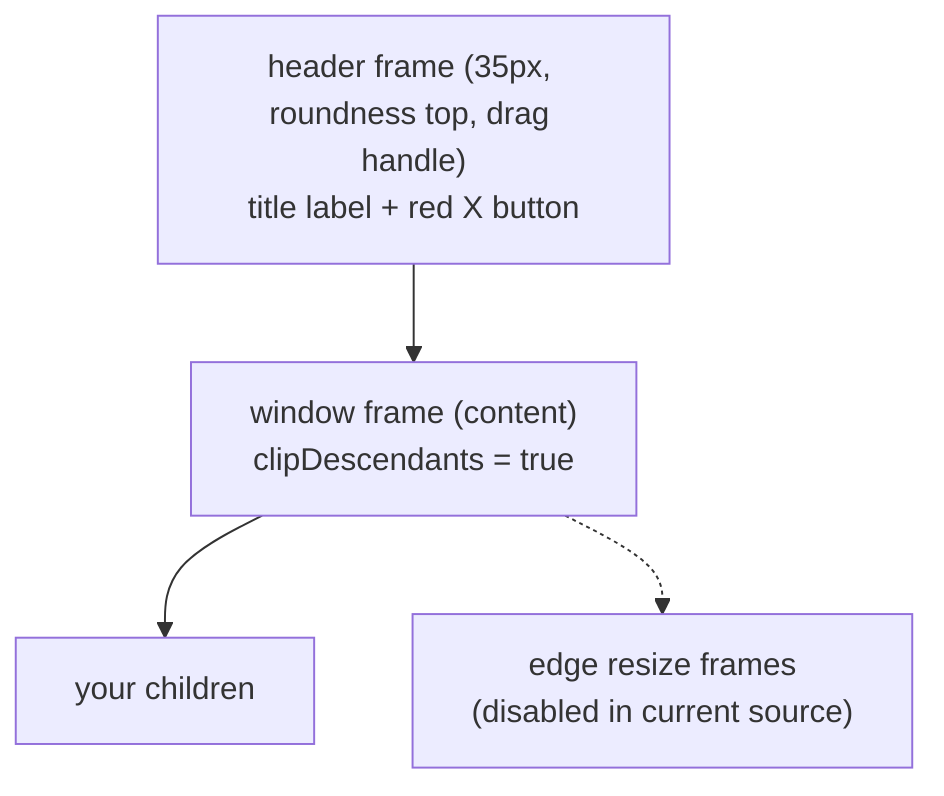

# Widgets (Add-ons)

Add-on modules extend the `gui` table with composite widgets. They mutate the library
directly and return nothing.

| Module | Loaded by `require("gui.addons")`? | Widgets |
|---|---|---|
| [`addons/extensions.lua`](../addons/extensions.lua) | ✅ yes | video player, checkbox, radio group, progress bar, number picker, color picker |
| [`addons/system.lua`](../addons/system.lua) | ❌ **opt-in** — `require("gui.addons.system")` | window, scroll frame, message box, task manager, file picker |
| [`addons/extensions_old.lua`](../addons/extensions_old.lua) | ❌ not loaded (legacy) | slider, tooltip, list frame, grid frame |
| [`core/menus.lua`](../core/menus.lua) | core | menu registry |

```lua
require("gui.addons")            -- extensions only
require("gui.addons.system")     -- + window / scroll frame / task manager / pickers UI
```

> **Order:** load addons *after* `require("gui")` — they capture the `gui` singleton.

---

## Table of Contents

1. [Window](#1-window)
2. [ScrollFrame](#2-scrollframe)
3. [MessageBox](#3-messagebox)
4. [Checkbox & RadioGroup](#4-checkbox--radiogroup)
5. [NumberPicker](#5-numberpicker)
6. [ColorPicker](#6-colorpicker)
7. [ProgressBar](#7-progressbar)
8. [VideoPlayer](#8-videoplayer)
9. [FilePicker](#9-filepicker)
10. [Task Manager](#10-task-manager)
11. [Menu registry (core)](#11-menu-registry-core)
12. [Legacy widgets](#12-legacy-widgets)

---

## 1. Window

```lua
require("gui.addons.system")

local win = gui:newWindow(x, y, w, h, sx, sy, sw, sh, "Title", draggable, theme)
```

[`system.lua` L441](../addons/system.lua:441). Structure: a rounded **header** frame
(35 px tall, drag handle) + a **content** frame below it (`clipDescendants = true`) +
red **X** button + (currently commented-out) resize handles. Each window owns its own
`multi` processor (`window_N`).

**Returns the content frame** — add children directly to it.

```lua
local panel = win:newTextLabel("Settings")
local ok    = win:newTextButton("OK", 10, 260, 100, 34)   -- auto-styled by theme
```

| API | Description |
|---|---|
| `win:setTitle(t)` | change header text (re-fits font) |
| `win:close()` / `win:OnClose(fn)` | hide (re-parent header to `gui.virtual`); fires `OnClose` |
| `win:open()` | restore to the original parent |
| `win:setTheme(th)` / `win:getTheme()` | re-apply / read theme |
| `win.XButton` | the close button element |
| `win.process` | the window's processor |

**Auto-theming:** any child created inside fires the window's `OnCreated` hook; buttons get
`colorButtonNormal/Highlight/Text` + hover swap + `fitFont`, text elements get
`colorPrimaryText` + `fontPrimary` ([`system.lua` L559–582](../addons/system.lua:559)).
Theme field shape: see [theming §4.4](theming-and-color.md#44-legacy-shape-in-add-ons).

**Drag:** when `draggable`, dragging the header moves the window and clamps it inside the
screen on release.



---

## 2. ScrollFrame

```lua
local content = parent:newScrollFrame(x, y, w, h, sx, sy, sw, sh)
```

[`system.lua` L158](../addons/system.lua:158). Viewport + auto-hiding vertical/horizontal
scrollbars (8 px). **Returns the content frame**; children beyond the viewport trigger the
bars.

```lua
local log = panel:newScrollFrame(0, 0, 0, 0, 0, 0, 1, 1)
for i = 1, 100 do
    log:newTextLabel("row " .. i, 0, (i-1)*20, 0, 20, 0, 0, 1)
    log:setContentSize(nil, 100 * 20)      -- grow the scrollable area
end
```

| API (on the returned content frame) | Description |
|---|---|
| `scrollTo(y[, x])` / `scrollBy(dy[, dx])` | absolute / relative scroll |
| `scrollToTop()` / `scrollToBottom()` | jump |
| `setScrollSpeed(px)` | wheel pixels per tick (default 40) |
| `getScrollPos()` → `x, y` / `getMaxScroll()` → `x, y` | queries |
| `setContentSize(w, h[, full])` | explicit content extent (`full` = keep scaled width) |

Wheel scrolling, draggable thumbs, and re-clamping on viewport/content resize are wired
internally. Destroying the viewport destroys content.

---

## 3. MessageBox

Modal-ish confirm dialog on top of `newWindow`
([`system.lua` L350](../addons/system.lua:350)):

```lua
local box = gui:newMessageBox({
    title   = "Confirm Action",
    message = "Are you sure you want to delete this task?",
    buttons = { "Yes", "No", "Cancel" },     -- default { "OK" }
    width   = 340,                           -- default; height auto-computed
    x = nil, y = nil,                        -- default: screen-centered
    theme   = nil,                           -- default: add-on default theme
    onChoice = function(label, idx)          -- also box.OnChoice connection
        if label == "Yes" then delete() end
    end,
})
```

- Buttons are evenly distributed; each fires `OnChoice(label, index)` then closes.
- Closing via the X fires `OnChoice(nil, nil)`.
- Returns the window (so `box:close()` / `box:open()` work).

---

## 4. Checkbox & RadioGroup

```lua
local cb = parent:newCheckbox("Enable sound", x, y, size, sx, sy, checked)

cb:check(true)            -- set state (fires OnChanged(value))
cb:isChecked()            -- bool
cb:getLabel()
cb.OnChanged(function(value) settings.sound = value end)
```

[`extensions.lua` L82](../addons/extensions.lua:82). Structure: dark outer frame, inset
white border, inner toggle square (visible = checked), optional label text.

### Radio group

```lua
local rg = parent:newRadioGroup({"Easy", "Normal", "Hard"}, x, y, sx, sy, size)

rg:getSelectedOption()                 -- the selected checkbox element
rg.OnSelectionChanged(function(group, selected) ... end)
```

[`extensions.lua` L120](../addons/extensions.lua:120) — built from checkboxes with
mutually-exclusive release handlers.

---

## 5. NumberPicker

Stepper field: `−` button, numeric text box, `+` button
([`extensions.lua` L259](../addons/extensions.lua:259)).

```lua
local picker = parent:newNumberPicker(x, y, w, h, sx, sy, sw, sh, {
    value    = 0,
    inc      = 1,
    decimals = 0,          -- 0 = integers
    min      = 0,          -- optional clamp
    max      = 255,
    onChange = function(n) print("new value:", n) end,
})

picker:setValue(42)        -- clamps, rounds, reformats; fires onChange
picker:getValue()
```

Input handling: typed text is sanitized to digits/minus/dot, normalized on
<kbd>Enter</kbd> or click-away (`OnReturn`/`OnPressedOuter`), arrows ↑/↓ step, and the
scroll wheel steps when focused. Buttons grey out at min/max.

---

## 6. ColorPicker

Full HSV picker: saturation/value square, hue strip, preview swatch, R/G/B number pickers,
and a hex input ([`extensions.lua` L460](../addons/extensions.lua:460)).

```lua
local cp = gui:newColorPicker(x, y, w, h, sx, sy, sw, sh, {
    r = 255, g = 0, b = 0,                -- initial color
    onChange = function(r, g, b)          -- 0-255, fires on any edit
        preview.color = {r/255, g/255, b/255}
    end,
})

local r, g, b = cp:getColor()             -- 0-255
cp:setColor(10, 200, 90)                  -- silent (no onChange)
```

Layout: SV square (left 55 %), hue strip, right column = swatch + R/G/B pickers + hex box
(accepts `RGB` shorthand or `RRGGBB`). Drag interaction on SV/hue uses the standard
press/move/release pattern; the SV gradient itself is drawn via the element's
[`post`](appearance-and-shaders.md#8-effects--post-hooks) hook with corner-gradient meshes.

---

## 7. ProgressBar

```lua
local bar, fill, percentLabel, fillframe = parent:newProgressBar(
    x, y, w, h, sx, sy, sw, sh, count, value)   -- count default 100, value default 0

bar:update(v[, drag])     -- set value (clamped); fires OnProgressUpdated
bar:add(n) / bar:sub(n)   -- relative
bar:max() / bar:min() / bar:half()
bar:getPercent()          -- rounded integer %
bar:getValue()
bar:showPercent(true)     -- render "N%" centered
bar:isClickable(true)     -- click/drag on the bar sets the value (seek-style)
bar.OnProgressUpdated(function(self, percent, value, drag) ... end)
```

[`extensions.lua` L149](../addons/extensions.lua:149). The video player's seek bar is a
clickable progress bar ([§8](#8-videoplayer)). Returns four handles so you can restyle
`fill`, the percentage label, or the inner frame.

---

## 8. VideoPlayer

Ready-made media window: video + play/pause image button + seekable progress bar
([`extensions.lua` L20](../addons/extensions.lua:20)).

```lua
local player = gui:newVideoPlayer("movie.ogv", x, y, w, h, sx, sy, sw, sh,
                                  draggable, theme)   -- theme optional (dark default)

player:play() / player:stop() / player:seek(seconds)
player:OnClose(function() end)     -- pauses playback automatically
```

Internals: `newWindow` + `newVideo` + `newImageButton` (icons from
[`gui/assets/`](../assets)) + clickable `newProgressBar`; a `media-updater` thread mirrors
`video:tell()` into the bar.

---

## 9. FilePicker

```lua
gui:newFilePicker(title, root, filter, callback)
-- title    : window title
-- root     : starting dir; relative paths resolve against the LÖVE save directory
-- filter   : list of allowed extensions (nil = all)
-- callback : function(path) called on selection

gui.OpenSaveDir(root)     -- opens the OS file browser at the save dir
```

[`system.lua` L1342](../addons/system.lua:1342). A themed window with breadcrumb nav,
scrollable directory listing (rows recycled through a pool), hidden-file handling, and a
"save dir" shortcut. Directory ops (`listDir`, `pread`, `isDir`) work on Windows and POSIX.

---

## 10. Task Manager

A scheduler debug window — live table of every processor/task/thread with columns
Name / Type / State / Status / Uptime / Priority / pause / kill, sortable headers, tab
bar (Tasks / Error Log), a load bar, per-row pause/kill buttons, and priority cycling
([`system.lua` L886](../addons/system.lua:886)).

```lua
require("gui.addons.system")
gui:showTaskManager()
```

Toggle hotkey: <kbd>Ctrl</kbd>+<kbd>\`</kbd> (`ToggleTaskManager` connection,
[`system.lua` L1068](../addons/system.lua:1068)).

Row pool + error pool recycle GUI objects so refreshes are cheap. State names map to the
multi thread states (`holding`, `sleeping`, `skipping`, `yielding`, `running`, …) and
priorities to the multi priority bands (`Core` … `Idle`).

---

## 11. Menu registry (core)

[`core/menus.lua`](../core/menus.lua) is a lazy menu manager, not a widget:

```lua
local menu = require("gui.core.menus")
menu.init(currentFrame)                       -- the container menus live in

menu.registerMenu("settings", function(frame, ...)
    -- build and return the menu's frame
end, deleteOnHide)                            -- delete = destroy instead of park

local settings = menu.getMenu("settings")
settings:visible(true, ...)                   -- first call builds; later calls re-show
menu.hideMenus()                              -- park/destroy all others
menu.getCurrentMenu()
```

`visible()` hides all other registered menus first (single-visible semantics). Hidden menus
either hide+park in `gui.virtual` or destroy themselves (`delete` flag).

---

## 12. Legacy widgets

[`extensions_old.lua`](../addons/extensions_old.lua) is **not required** anywhere. It
contains earlier implementations worth knowing exist (signatures from its header
comments):

```lua
parent:newSlider(min, max, value, x, y, w, h, sx, sy, vertical)
parent:newSlider(...):setValue(v) / :getValue() / :setRange(min, max)
   -- OnValueChanged(self, value)

local tt = gui:newTooltip(text, delay)
tt:attach(element)        -- shows after hover delay

parent:newListFrame(x, y, w, h, sx, sy, sw, sh,
                    {direction="vertical"|"horizontal", gap=4, padding=6})
   -- auto-stacks children

parent:newGridFrame(cols, cellW, cellH, x, y, sx, sy, gap, padding)
   -- slot-based grid; newCheckbox/newSlider auto-wrap into cells
```

If you adopt these, `require("gui.addons.extensions_old")` — expect drift (it predates the
current `newTextArea` in core, which it also defines).
