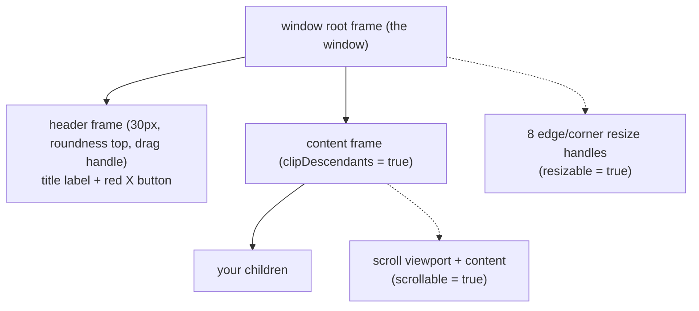

# Widgets (Add-ons)

Add-on modules extend the `gui` table with composite widgets. They mutate the library
directly and return nothing.

| Module | Loaded by `require("gui.addons")`? | Widgets |
|---|---|---|
| [`addons/extensions/`](../addons/extensions/) | ✅ yes — `addons/extensions.lua` requires each widget file | video player, checkbox, radio group, progress bar, number picker, color picker, list frame |
| [`addons/system.lua`](../addons/system.lua) | ❌ **opt-in** — `require("gui.addons.system")` | window, scroll frame, message box, task manager, file picker |
| [`addons/extensions_old.lua`](../addons/extensions_old.lua) | ❌ not loaded (legacy) | slider, tooltip, list frame, grid frame |
| [`core/menus.lua`](../core/menus.lua) | core | menu registry |

```lua
require("gui.addons")            -- extensions only
require("gui.addons.system")     -- + window / scroll frame / task manager / pickers UI
```

> **Order:** load addons *after* `require("gui")` — they capture the `gui` singleton.

---

## Table of Contents

1. [Window](#1-window)
2. [ScrollFrame](#2-scrollframe)
3. [MessageBox](#3-messagebox)
4. [Checkbox & RadioGroup](#4-checkbox--radiogroup)
5. [NumberPicker](#5-numberpicker)
6. [ColorPicker](#6-colorpicker)
7. [ProgressBar](#7-progressbar)
8. [VideoPlayer](#8-videoplayer)
9. [FilePicker](#9-filepicker)
10. [Task Manager](#10-task-manager)
11. [Menu registry (core)](#11-menu-registry-core)
12. [ListFrame](#12-listframe)
13. [Legacy widgets](#13-legacy-widgets)

---

## 1. Window

```lua
require("gui.addons.system")

local win = gui:newWindow{
    x, y, w, h, sx, sy, sw, sh,   -- optional geometry (dualDim)
    title      = "Title",
    draggable  = true,            -- header drag (default true)
    resizable  = false,           -- edge/corner resize handles
    scrollable = false,           -- content auto-scrolls when children exceed it
    minW = 200, minH = 120,       -- resize clamps (max = screen bounds)
    headerHeight = 30,
    theme = theme:newTheme("#124559"),   -- new-framework theme table or preset
    fonts = { primary = f, button = f },
    onClose = function(win) end,
}
```

[`system.lua`](../addons/system.lua). Structure: a rounded **header** frame
(30 px default, drag handle) + a **content** frame below it (`clipDescendants = true`)
+ red **X** button. Each window owns its own `multi` processor (`window_N`), destroyed
with the window.

**Returns the window root frame** — add children to `win.content`:

```lua
local panel = win.content:newTextLabel("Settings")
local ok    = win.content:newTextButton("OK", 10, 260, 100, 34)   -- auto-styled by theme
```

| API | Description |
|---|---|
| `win.content` / `win.header` / `win.title` / `win.XButton` | the window parts (`win.root == win`) |
| `win:setTitle(t)` / `win:getTitle()` | change / read header text (re-fits font) |
| `win:close()` / `win:OnClose(fn)` | hide (re-parent to `gui.virtual`); fires `OnClose` |
| `win:open()` | restore to the original parent |
| `win:destroy()` | tear down the whole window **and its processor** |
| `win:setTheme(th[, fonts])` / `win:getTheme()` | re-apply / read theme |
| `win.XButton` | the close button element |
| `win.process` | the window's processor |
| `win.handles` | the 8 resize-handle frames (only when `resizable`) |

**Drag & resize:** when `draggable`, dragging the header moves the window and clamps it
inside the screen on release. When `resizable`, eight invisible edge/corner handles
(N/S/E/W/NE/NW/SE/SW) resize with `minW/minH` clamps and resize cursors. Clicking a
window raises it above siblings (`topStack`).

**Auto-theming:** any child created inside the window is styled from the **new theme
framework** slots (`primaryBG` content, `primaryNav` header, `primaryText` text,
`primaryButton` buttons with lighten-hover). See
[theming §4.4](theming-and-color.md#44-legacy-shape-in-add-ons) — the legacy
`colorPrimary…` shape is no longer used by these widgets.



---

## 2. ScrollFrame

```lua
local content = parent:newScrollFrame(x, y, w, h, sx, sy, sw, sh)
```

[`system.lua`](../addons/system.lua). Viewport + auto-hiding vertical/horizontal
scrollbars (8 px). **Returns the content frame**; children beyond the viewport trigger the
bars.

```lua
local log = panel:newScrollFrame(0, 0, 0, 0, 0, 0, 1, 1)
log:autoMeasure(true)                     -- extent follows the children automatically
for i = 1, 100 do
    log:newTextLabel("row " .. i, 0, (i-1)*20, 0, 20, 0, 0, 1)
end
```

| API (on the returned content frame) | Description |
|---|---|
| `scrollTo(y[, x])` / `scrollBy(dy[, dx])` | absolute / relative scroll |
| `scrollToTop()` / `scrollToBottom()` | jump |
| `setScrollSpeed(px)` | wheel pixels per tick (default 40) |
| `getScrollPos()` → `x, y` / `getMaxScroll()` → `x, y` | queries |
| `setContentSize(w, h[, full])` | explicit content extent (`full` = keep scaled width) |
| `autoMeasure([bool])` | grow the extent from children each update pass (off by default; on for `scrollable` windows; skipped when flex/grid-managed) |
| `markDirty()` | force a re-measure next pass |

Wheel scrolling, draggable thumbs, and re-clamping on viewport/content resize are wired
internally. Destroying the viewport destroys content.

---

## 3. MessageBox

Modal-ish confirm dialog on top of `newWindow`
([`system.lua` L350](../addons/system.lua:350)):

```lua
local box = gui:newMessageBox({
    title   = "Confirm Action",
    message = "Are you sure you want to delete this task?",
    buttons = { "Yes", "No", "Cancel" },     -- default { "OK" }
    width   = 340,                           -- default; height auto-computed
    x = nil, y = nil,                        -- default: screen-centered
    theme   = nil,                           -- default: add-on default theme
    onChoice = function(label, idx)          -- also box.OnChoice connection
        if label == "Yes" then delete() end
    end,
})
```

- Buttons are evenly distributed; each fires `OnChoice(label, index)` then closes.
- Closing via the X fires `OnChoice(nil, nil)`.
- Returns the window (so `box:close()` / `box:open()` work).

---

## 4. Checkbox & RadioGroup

```lua
local cb = parent:newCheckbox("Enable sound", x, y, size, sx, sy, checked)

cb:check(true)            -- set state (fires OnChanged(value))
cb:isChecked()            -- bool
cb:getLabel()
cb.OnChanged(function(value) settings.sound = value end)
```

[`checkbox.lua` L11](../addons/extensions/checkbox.lua:11). Structure: dark outer frame, inset
white border, inner toggle square (visible = checked), optional label text.

### Radio group

```lua
local rg = parent:newRadioGroup({"Easy", "Normal", "Hard"}, x, y, sx, sy, size)

rg:getSelectedOption()                 -- the selected checkbox element
rg.OnSelectionChanged(function(group, selected) ... end)
```

[`checkbox.lua` L49](../addons/extensions/checkbox.lua:49) — built from checkboxes with
mutually-exclusive release handlers.

---

## 5. NumberPicker

Stepper field: `−` button, numeric text box, `+` button
([`numberpicker.lua` L7](../addons/extensions/numberpicker.lua:7)).

```lua
local picker = parent:newNumberPicker(x, y, w, h, sx, sy, sw, sh, {
    value    = 0,
    inc      = 1,
    decimals = 0,          -- 0 = integers
    min      = 0,          -- optional clamp
    max      = 255,
    onChange = function(n) print("new value:", n) end,
})

picker:setValue(42)        -- clamps, rounds, reformats; fires onChange
picker:getValue()
```

Input handling: typed text is sanitized to digits/minus/dot, normalized on
<kbd>Enter</kbd> or click-away (`OnReturn`/`OnPressedOuter`), arrows ↑/↓ step, and the
scroll wheel steps when focused. Buttons grey out at min/max.

---

## 6. ColorPicker

Full HSV picker: saturation/value square, hue strip, preview swatch, R/G/B number pickers,
and a hex input ([`colorpicker.lua` L64](../addons/extensions/colorpicker.lua:64)).

```lua
local cp = gui:newColorPicker(x, y, w, h, sx, sy, sw, sh, {
    r = 255, g = 0, b = 0,                -- initial color
    onChange = function(r, g, b)          -- 0-255, fires on any edit
        preview.color = {r/255, g/255, b/255}
    end,
})

local r, g, b = cp:getColor()             -- 0-255
cp:setColor(10, 200, 90)                  -- silent (no onChange)
```

Layout: SV square (left 55 %), hue strip, right column = swatch + R/G/B pickers + hex box
(accepts `RGB` shorthand or `RRGGBB`). Drag interaction on SV/hue uses the standard
press/move/release pattern; the SV gradient itself is drawn via the element's
[`post`](appearance-and-shaders.md#8-effects--post-hooks) hook with corner-gradient meshes.

---

## 7. ProgressBar

```lua
local bar, fill, percentLabel, fillframe = parent:newProgressBar(
    x, y, w, h, sx, sy, sw, sh, count, value)   -- count default 100, value default 0

bar:update(v[, drag])     -- set value (clamped); fires OnProgressUpdated
bar:add(n) / bar:sub(n)   -- relative
bar:max() / bar:min() / bar:half()
bar:getPercent()          -- rounded integer %
bar:getValue()
bar:showPercent(true)     -- render "N%" centered
bar:isClickable(true)     -- click/drag on the bar sets the value (seek-style)
bar.OnProgressUpdated(function(self, percent, value, drag) ... end)
```

[`progressbar.lua` L11](../addons/extensions/progressbar.lua:11). The video player's seek bar is a
clickable progress bar ([§8](#8-videoplayer)). Returns four handles so you can restyle
`fill`, the percentage label, or the inner frame.

---

## 8. VideoPlayer

Ready-made media window: video + play/pause image button + seekable progress bar
([`videoplayer.lua` L9](../addons/extensions/videoplayer.lua:9)).

```lua
local player = gui:newVideoPlayer("movie.ogv", x, y, w, h, sx, sy, sw, sh,
                                  draggable, theme)   -- theme optional (dark default)

player:play() / player:stop() / player:seek(seconds)
player:OnClose(function() end)     -- pauses playback automatically
```

Internals: `newWindow` + `newVideo` + `newImageButton` (icons from
[`gui/assets/`](../assets)) + clickable `newProgressBar`; a `media-updater` thread mirrors
`video:tell()` into the bar.

---

## 9. FilePicker

```lua
gui:newFilePicker(title, root, filter, callback)
-- title    : window title
-- root     : starting dir; relative paths resolve against the LÖVE save directory
-- filter   : list of allowed extensions (nil = all)
-- callback : function(path) called on selection

gui.OpenSaveDir(root)     -- opens the OS file browser at the save dir
```

[`system.lua` L1342](../addons/system.lua:1342). A themed window with breadcrumb nav,
scrollable directory listing (rows recycled through a pool), hidden-file handling, and a
"save dir" shortcut. Directory ops (`listDir`, `pread`, `isDir`) work on Windows and POSIX.

---

## 10. Task Manager

A scheduler debug window — live table of every processor/task/thread with columns
Name / Type / State / Status / Uptime / Priority / pause / kill, sortable headers, tab
bar (Tasks / Error Log), a search box + type filter, a load bar, per-row quick actions,
priority cycling, and an **inspector pane** with the full multi control matrix
([`system.lua`](../addons/system.lua)).

```lua
require("gui.addons.system")
gui:showTaskManager()      -- idempotent: re-opens after close
```

Toggle hotkey: <kbd>Ctrl</kbd>+<kbd>\`</kbd> (`ToggleTaskManager` connection,
end of [`system.lua`](../addons/system.lua)).

- **Data pipeline:** a 1 Hz collector thread (on the window's processor, gated on the
  window being open) builds a snapshot from `multi:getStats()`; the GUI applies it on an
  UpdateManager pass through a recycled row pool. Sort is **group-preserving** — each
  processor header stays pinned above its own rows.
- **Row quick actions:** Pause/Resume, Kill (`Kill`/`Destroy`/`Break` as available), and
  priority cycling. Clicking a row selects it for the inspector.
- **Inspector matrix** (per selected object): rename (`setName`), priority cycle /
  `ResetPriority`; actors: `Pause/Resume/Break/Reset/Destroy`, `SetTime`/`ResolveTimer`;
  threads: `Kill`, `Sleep`; processors: `Start/Stop/boost/Destroy`, `setMaxThreads`,
  `setTaskDelay`; services: `Start/Stop/Pause/Resume`; connectors: `Destroy`; plus
  `reallocate` to another processor and UID/creation-timestamp readout.
- **Errors tab:** every thread's `OnError` is hooked retroactively and for future
  threads/processors (plus the thread-manager process); capped at 200 entries, Clear
  button. State names map to the multi thread states (`holding`, `sleeping`, `skipping`,
  `yielding`, `running`, …) and priorities to the multi priority bands (`Core` … `Idle`).
- **Load bar:** `core/probe.lua` `install(multi)` → non-blocking `multi:getLoad()`.

---

## 11. Menu registry (core)

[`core/menus.lua`](../core/menus.lua) is a lazy menu manager, not a widget:

```lua
local menu = require("gui.core.menus")
menu.init(currentFrame)                       -- the container menus live in

menu.registerMenu("settings", function(frame, ...)
    -- build and return the menu's frame
end, deleteOnHide)                            -- delete = destroy instead of park

local settings = menu.getMenu("settings")
settings:visible(true, ...)                   -- first call builds; later calls re-show
menu.hideMenus()                              -- park/destroy all others
menu.getCurrentMenu()
```

`visible()` hides all other registered menus first (single-visible semantics). Hidden menus
either hide+park in `gui.virtual` or destroy themselves (`delete` flag).

---

## 12. ListFrame

```lua
local list = parent:newListFrame(x, y, w, h, sx, sy, sw, sh, opts)
```

[`extensions/listframe.lua`](../addons/extensions/listframe.lua). Scrollable single-selection list of
rows on top of `newScrollFrame` (autoMeasure on, so the box scrolls when items
overflow). Selection paints `theme.primaryNav`; hover tints with a lightened
`primaryBG`; press darkens one step further. All state changes ride one shared
tween loop (~150 ms exponential settle): adds fade + slide in with a short
stagger, removes fade out and **collapse** while neighbours reflow, and an
off-screen selection smooth-scrolls the viewport into place. Keyboard-driven
selection snaps instantly — a key pressed hundreds of times a session must never
animate. `animate = false` opts out entirely (state lands same-frame).

```lua
local files = gui:newListFrame(20, 60, 320, 300, 0, 0, 0, 0, {
    items     = { { text = "Alpha", value = 1 }, "Bravo", "Charlie" },
    keyboard  = true,                  -- ↑↓ PgUp PgDn Home End Del once focused
    emptyText = "Nothing here yet",    -- placeholder while the list is empty
    striped   = false,                 -- alternating row fill
    rowHeight = 28, gap = 2, align = gui.ALIGN_LEFT, scale = .85,
    onChange        = function(index, value) end,
    onDoubleClicked = function(index, value) end,
    onRightClick    = function(index, value, mx, my) end,
})

files:add("Delta", 4)                   -- returns the row frame
files:insert(2, "Echo", 42)            -- live index: lands before old row 2
files:remove(files:getSelected())      -- collapse + reflow + selection reassign
files:select(4)                        -- smooth-scrolls into view if clipped
local i, v = files:getSelected()
```

| API | Description |
|---|---|
| `add(text[, value])` / `insert(i, text[, value])` | append / insert at live index (row frame returned) |
| `setItems(items)` | replace everything (strings or `{text=, value=}` tables) |
| `remove(i)` → value / `removeValue(value)` → index, text | animated removal; selection reassigns to the next live row and fires the change event |
| `clear([animate])` | remove all (`animate=false` destroys immediately) |
| `select(i[, animate])` / `setSelected(i[, animate])` | select + fire events / silent variant; index or row frame accepted |
| `getSelected()` → `index, value` | `nil, nil` when nothing selected |
| `getItem(i)` / `getItems()` / `getItemCount()` / `indexOf(value)` / `isEmpty()` | queries (live indices — collapsing rows are never visible to the API) |
| `scrollToShow(i)` | smooth-scroll a row into view |
| `getRow(i)` / `getEmptyLabel()` | advanced access (row color is tween-driven — restyle via opts, don't write `row.color`) |
| `isSettling()` | transitions still in flight (debug/testing) |
| `setFocused(bool)` / `isFocused()` | keyboard-nav focus; also automatic (press inside focuses, press outside clears) |
| `OnSelectionChanged` | connection, `:Fire(index, value)` like `onChange` |

Colors: `selectedColor` / `hoverColor` / `stripedColor` / `textColor` /
`emptyTextColor` / `backgroundColor` (viewport paint; default transparent).
Rows are full-width frames with an `ignore`d label, so clicks always reach the
row. Wheel scrolling and scrollbars come from the underlying ScrollFrame.

> **Note:** `newListFrame` in [`extensions_old.lua`](../addons/extensions_old.lua)
> (§13) is a different, older auto-stacking widget that overrides this one if you
> require it. The modern version above is what `require("gui.addons")` installs.
> Demo + autotest: [`examples/list-demo/`](../examples/list-demo/main.lua:1)
> (`love examples/list-demo --list-autotest`, 54 checks).

---

## 13. Legacy widgets

[`extensions_old.lua`](../addons/extensions_old.lua) is **not required** anywhere. It
contains earlier implementations worth knowing exist (signatures from its header
comments):

```lua
parent:newSlider(min, max, value, x, y, w, h, sx, sy, vertical)
parent:newSlider(...):setValue(v) / :getValue() / :setRange(min, max)
   -- OnValueChanged(self, value)

local tt = gui:newTooltip(text, delay)
tt:attach(element)        -- shows after hover delay

parent:newListFrame(x, y, w, h, sx, sy, sw, sh,
                    {direction="vertical"|"horizontal", gap=4, padding=6})
   -- auto-stacks children (superseded by the modern ListFrame in §12;
   -- requiring extensions_old overrides gui:newListFrame with this one)

parent:newGridFrame(cols, cellW, cellH, x, y, sx, sy, gap, padding)
   -- slot-based grid; newCheckbox/newSlider auto-wrap into cells
```

If you adopt these, `require("gui.addons.extensions_old")` — expect drift (it predates the
current `newTextArea` in core, which it also defines).
