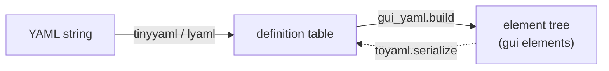

# YAML Declarative UI

Build entire element trees from data instead of imperative calls. The builder lives in
[`gui/yaml/builder.lua`](../yaml/builder.lua); a bundled parser
([`tinyyaml.lua`](../yaml/tinyyaml.lua)) and a serializer
([`toyaml.lua`](../yaml/toyaml.lua)) round-trip the format.

```lua
local gui_yaml = require("gui.yaml.builder")

-- From a parsed table:
local tinyyaml = require("gui.yaml.tinyyaml")
local def  = tinyyaml.parse(io_string)
local root = gui_yaml.build(gui, def)

-- Or one-shot from a string (tries tinyyaml, then lyaml):
local root = gui_yaml.fromString(gui, yaml_string, env)

-- Multiple roots in one document:
local roots = gui_yaml.buildMany(gui, defList, env)
```



`env` is an optional table used to resolve event-handler names to functions
(otherwise handlers resolve as global functions, or inline Lua strings — see §4).

The full annotated example lives in
[`docs/yaml-based-elements.yaml`](yaml-based-elements.yaml); this document explains it.

---

## 1. Element types

`type:` selects the constructor ([`builders` table, builder.lua L319](../yaml/builder.lua:319)):

| `type` | Constructor |
|---|---|
| `frame` | `newFrame` |
| `virtual-frame` | `newVirtualFrame` |
| `visual-frame` | `newVisualFrame` |
| `label` | `newTextLabel` |
| `button` | `newTextButton` |
| `textbox` | `newTextBox` |
| `image` | `newImageLabel` |
| `image-button` | `newImageButton` |
| `video` | `newVideo` |

Unknown types error loudly. `children:` is a list; each entry recurses through the same
builder ([`build`, L362](../yaml/builder.lua:362)).

---

## 2. Position & size

Both spellings are accepted ([`parseDualDim`, L29](../yaml/builder.lua:29)):

```yaml
# flat:
x: 10
y: 10
w: 200
h: 50
sx: 0.0
sy: 0.0
sw: 0.5
sh: 1.0

# grouped:
pos:  [10, 10]
size: [200, 50]
scale-pos:  [0.0, 0.0]
scale-size: [0.5, 1.0]

full-frame: true        # shorthand for fill-parent
```

Semantics identical to the [layout system](layout-system.md).

---

## 3. Shared & type-specific properties

### Shared (every type) — [`applyShared`, L51](../yaml/builder.lua:51)

```yaml
color:        "#3a7bd5"          # hex string, or [r,g,b] 0-255 / 0-1, or {r,g,b,a}
border-color: "#000000"
draw-border:  false
visible:      true
active:       true
visibility:   1.0
rotation:     45
tag:  my-element                # single tag
tags: [draggable-panel, visual] # multi tag
form: circle                    # or: rectangle | arc
  # circle fields: radius, segments
  # arc fields: radius, arc-type (open|closed|pie), angle-start, angle-end, segments
roundness: 8                    # int | [rx, ry, segments] | top | bottom | {side: top}
center-x: true
center-y: true
square: w                       # or h
draggable: 1                    # mouse button; false/omit = off
respect-hierarchy: true
clip-descendants: true
stack: top                      # or bottom
effect: myEffectFn              # function name (resolved in env/_G)
shader: myShader                # name lookup; userdata passes through
```

### Text types (`label`, `button`, `textbox`) — [`applyTextProps`, L216](../yaml/builder.lua:216)

```yaml
text: "Hello, world!"
align: left                     # left | center | right
text-color: "#ffffff"
text-visibility: 1.0
text-scale:  [1.0, 1.0]
text-offset: [0, 0]
text-shear:  [0, 0]
font: 16                        # size
font: "fonts/Roboto.ttf"        # path + font-size
font-size: 18
font: {file: "fonts/Roboto.ttf", size: 18}
fit-font: true                  # or {min: 8, max: 200, scale: 0.95}
center-font: true               # or numeric offset
```

### Image types (`image`, `image-button`) — [`applyImageProps`, L269](../yaml/builder.lua:269)

```yaml
source: "assets/logo.png"
tile: [0, 0, 64, 64]            # sub-quad into a spritesheet
scale-x: 1.0
scale-y: 1.0
flip: horizontal                # horizontal | vertical | both
image-color: "#ffffff"
image-visibility: 1.0
gradient:
  direction: vertical
  colors: [[255,80,80,255], [80,80,255,255]]
```

### Video — [`applyVideoProps`, L305](../yaml/builder.lua:305)

```yaml
source: "assets/intro.ogv"
volume: 0.8
autoplay: true
video-color: "#ffffff"
video-visibility: 1.0
```

---

## 4. Events & hotkeys

[`applyEvents`, L155](../yaml/builder.lua:155) maps YAML keys to connections:

| YAML key | Connection |
|---|---|
| `on-pressed` / `on-released` | `OnPressed` / `OnReleased` |
| `on-pressed-outer` / `on-released-outer` | `OnPressedOuter` / `OnReleasedOuter` |
| `on-enter` / `on-exit` / `on-moved` | hover trio |
| `on-drag-start` / `on-dragging` / `on-drag-end` | drag trio |
| `on-wheel` | `OnWheelMoved` |
| `on-size-changed` / `on-position-changed` | layout |
| `on-destroy` / `on-load` | lifecycle |
| `on-return` | textbox submit |
| `on-update` | per-frame (uses `obj:OnUpdate`) |

Handler values resolve in this order:

1. a Lua **function** already in the table (possible when calling `build` directly);
2. a **global function name** string (`_G[name]`);
3. an **`env` table** entry by name.

```yaml
on-pressed: "handleClick"        # _G.handleClick
on-pressed: |
  print("pressed!", self.text)   # inline source string
```

> Note: the current resolver returns the *string* for inline blocks unless `env` supplies
> a function of that name — inline Lua blocks are documented in the example YAML but the
> loader only wires up functions it can resolve. Prefer function names in `env` for real
> projects.

Hotkeys:

```yaml
hotkeys:
  - keys: [lctrl, s]
    action: "saveDocument"
  - keys: [escape]
    action: "closeDialog"
```

---

## 5. Full example

```yaml
type: frame
tag: main-menu
color: "#1c1c24"
full-frame: true
children:
  - type: label
    text: "JEOPARDY!"
    x: 0
    y: 40
    w: 0
    h: 90
    sx: 0
    sy: 0
    sw: 1
    sh: 0
    align: center
    font: "assets/fonts/gyparody.ttf"
    font-size: 64
    text-color: "#30C5FF"

  - type: button
    text: "Play"
    x: -100
    y: 0
    w: 200
    h: 56
    sx: 0.5
    sy: 0.45
    on-released: "onPlayClicked"
    color: "#73bf76"

  - type: image
    source: "assets/images/background.jpg"
    full-frame: true
    image-visibility: 0.3
    children: []
```

Build & wire:

```lua
local env = {
    onPlayClicked = function() startGame() end,
}
local def  = require("gui.yaml.tinyyaml").parse(text)
local menu = gui_yaml.build(gui, def, env)
```

---

## 6. Serializer (`toyaml`)

The module *is* the function: [`gui/yaml/toyaml.lua`](../yaml/toyaml.lua) returns
`guiToYaml(obj, opts)`, which walks a live element tree back into YAML text — resolving
the type name from the [type bitmask](architecture.md#10-type-bitmasks), emitting non-zero
dualDim slots, colors (as `[r,g,b]` 0-255, or `#hex` when the color object exposes
`toHex`), text/image/video fields, and nested `children`. Handy for scene editors and
save files.

```lua
local guiToYaml = require("gui.yaml.toyaml")

local text = guiToYaml(rootFrame, {
    indent          = 0,
    skipDefaults    = true,     -- omit fields equal to library defaults (default true)
    includeChildren = true,     -- recurse (default true)
    eventNames      = {},       -- optional: {[connectionObject] = "handlerName"}
})
-- feed back through gui_yaml.fromString to restore
```

Known limitations:

- `image-button` serializes as `image` — the library doesn't set the button bit
  ([elements §4.2](elements.md#42-imagebutton)).
- `dualDimToYaml` assumes a nested `dualDim` shape
  (`dd.offset.pos/.size`, `dd.scale.pos/.size`), but `newDualDim` produces a **flat**
  table (`offsetX/scaleX/...`) — the serializer currently emits no geometry for
  core-created elements. Validate round-trips on your trees (fix tracked alongside
  [`gui/fixes.md`](../fixes.md)).
- Events are only emitted when you pass the `eventNames` map; otherwise handlers are
  dropped from the output.
