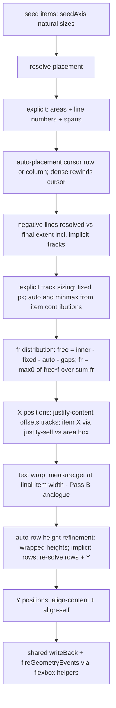

# CSS Grid Integration Plan — Extending the Flexbox Seam in the LÖVE GUI Library

Status: approved-scope plan (planning only, no Lua implemented).
Scope source: CSS-Tricks complete-guide subset (user-approved). Non-goals: subgrid, named grid lines (as a standalone feature), masonry, new config/provider systems.

---

## 0. Ground truth verified by reading the code

| Fact | Location |
|---|---|
| Flex engine owns per-root pipeline: seed → C0 → A(x) → B(text wrap) → aspect → C1 → D(y) → F(positions) → square bake → write-back → delta events | [`core/flexbox.lua:550-751`](../core/flexbox.lua:550) |
| Write-back linchpin: pass rewrites *dualDim values* via `rawSetDualDim` (offsets vs parent, scales zeroed); downstream resolver reproduces pixels exactly | [`core/flexbox.lua:691-712`](../core/flexbox.lua:691), [`init.lua:371-391`](../init.lua:371) |
| Single scheduler `runPass(tree)`: weak `allFlex` registry, roots sorted by depth, dirty gate + seed re-check, `running`/`deferred` re-entrancy guards, `measure.beginPass()` once per run | [`core/flexbox.lua:782-860`](../core/flexbox.lua:782) |
| `isFlexRoot(e)` = `e.__flex` and parent has no `__flex` (or e is floating). A `__grid` element under a `__flex` parent is therefore *already* an independent root if the check is generalized | [`core/flexbox.lua:90-94`](../core/flexbox.lua:90) |
| Depth-ordered roots + `__flexFrame` pass stamp let a nested root seed from the parent's *fresh same-pass* absolutes (`absolutesWith(p.__fx…)`), else from the draw cache (`safeAbsolutes`) | [`core/flexbox.lua:767-826`](../core/flexbox.lua:767) |
| Escape hatch: `onManualGeometry` on `move/size/setDualDim/rawSetDualDim`; `__flexEscaped` children float, excluded from flow but still descendants | [`core/flexbox.lua:866-885`](../core/flexbox.lua:866), [`init.lua:301-423`](../init.lua:301) |
| Lifecycle hooks (all nil-guarded, mode-agnostic today only for `__flex`): `onChildAdded` (newBase), `onChildRemoved` (destroy/setParent), `onParentSet`, `markDirty` walk-up-to-root | [`core/flexbox.lua:171-183, 888-907`](../core/flexbox.lua:171), [`init.lua:506-518, 724, 1106`](../init.lua:506) |
| Child item primitives shared by every pass: `seedAxis` (fit natural size from text measure / image dims), `sizingOf`, `isTextElement`, `isFloating`, `textMeasureOpts` | [`core/flexbox.lua:78-210`](../core/flexbox.lua:78) |
| `setFlex`/`setSizing` validation style: unknown keys/values → `error()` naming the element; numbers clamped ≥ 0; late injection `flexbox.init(gui,…)` installs `gui.setFlex/setSizing` | [`core/flexbox.lua:940-1111, 1157-1161`](../core/flexbox.lua:940), [`init.lua:2580`](../init.lua:2580) |
| `sizeManaged(elem)` = scroll-content root: pass owns size slots only; used by demo via `flexbox.sizeManaged(SF,true)`; `addons/system.lua` itself contains **zero** flexbox references | [`core/flexbox.lua:917-921`](../core/flexbox.lua:917), [`examples/flex-demo/main.lua:623-632`](../examples/flex-demo/main.lua:623) |
| Measurement seam (unchanged by grid): `measure.get(text, font, width, opts)` → `{width,height,lines}`, generation cache; `measure.natural` | [`core/measure.lua:75-136`](../core/measure.lua:75) |
| YAML seam: `applyShared` maps `flex:`/`sizing:` → `setFlex`/`setSizing`; `coerceNumericStrings` fixes tinyyaml flow-style string numbers; `padding: [l,r,t,b]` sequence normalized | [`yaml/builder.lua:53-63, 168-197`](../yaml/builder.lua:53) |
| Verification pattern: `verify.rect` numeric compare (EPS 1e-9) on `getAbsolutes()`; `verify.invariant` → `flexbox.debugVerifySubtree`; frame-phased `expectRect` checks; idle gate `stats.visited` delta == 0; `--flex-headless`/`--flex-autotest`; exit code = failures | [`examples/flex-demo/verify.lua:11-29`](../examples/flex-demo/verify.lua:11), [`examples/flex-demo/main.lua:61-81, 710-784`](../examples/flex-demo/main.lua:61) |
| Prior plan-doc conventions (ground-truth table, file-by-file edits, data model, algorithm pseudocode, acceptance §8) | [`docs/flexbox-integration-plan.md`](../docs/flexbox-integration-plan.md) |

No `grid` code exists anywhere in `core/`.

---

## 1. Reuse decision: new `core/grid.lua`, with `flexbox.lua` staying the lifecycle owner

**Decision: `core/grid.lua` implements the grid algorithm; `core/flexbox.lua` is generalized (not forked) to own the shared root/lifecycle seam for both modes.**

Justification from actual code structure:

1. The *algorithm* in flexbox.lua is fundamentally 1-D flow (Pass A/D `sizeAlongAxis`, Pass F cursor). Grid needs 2-D track sizing + placement + dense packing. Inlining it would add ~700 lines to a 1164-line file and interleave two unrelated algorithms — that is duplication-by-mixing, not reuse.
2. The *seam* around the algorithm is mode-agnostic and already generic-shaped: weak registry `allFlex`, `isFlexRoot`, `markDirty`, `runPass` (depth sort, dirty gate, seed re-check, re-entrancy), escape hatch, `sizeManaged`, `debugVerifySubtree`, event guards (`writing`/`firing`), and the six `init.lua` hooks. Grid gets all of this for free by being a second root mode. **Zero new `init.lua` hooks are needed.**
3. Cross-mode nesting falls out of the existing root model: `isFlexRoot` already returns true when the parent lacks `__flex`, so a flex container inside a grid container is naturally its own root; generalizing the check makes a grid container inside a flex container naturally its own root too. Depth ordering + the `__flexFrame` stamp (grid stamps the same field) guarantees a nested root seeds from the parent's fresh same-pass absolutes.
4. Write-back/event-firing/`sizeManaged` logic must not be duplicated (ownership + invariant risk): extracted once from `layoutFlexRoot` into shared helpers used by both modes.

Refactor budget (the "only if patching would duplicate/weaken" bar): three small extractions in flexbox.lua (`writeBack`, `fireGeometryEvents`, and a `markDirty`/hook predicate `isLayoutElem`), plus generalization of `isFlexRoot`, `seedAxis`, `propagateUp`, `debugVerifySubtree`, `runPass` dispatch. Existing flex behavior is untouched where `__grid` is absent; every generalized check is an `or` extension.

Dependency direction: `grid.lua` requires `gui.core.measure` at load and `gui.core.flexbox` at load (for shared helpers). `flexbox.lua` requires `gui.core.grid` **lazily inside function bodies** (pcall, nil-guarded — same pattern `init.lua:7` uses for flexbox itself), so there is no require cycle, and deleting `core/grid.lua` disables grid without breaking flex (mirrors the documented "removing flexbox.lua disables the feature" property in [`docs/flexbox.md:13-16`](../docs/flexbox.md:13)).

---

## 2. Data model

```lua
-- Container: frame:setGrid{...}  (parallel to __flex; a container may have either, never both)
elem.__grid = {
    columns = <parsed track list>,      -- from grid-template-columns
    rows    = <parsed track list>,      -- from grid-template-rows
    areas   = { [name] = {c1,r1,c2,r2}, ... },  -- from grid-template-areas
    colGap = 0, rowGap = 0,             -- gap / column-gap / row-gap (clamped >= 0)
    autoFlow = "row" | "column",        -- default "row"
    dense    = false,
    justifyItems = "stretch"|"start"|"end"|"center",   -- default "stretch"
    alignItems   = "stretch"|...,
    justifyContent = "start"|"center"|"end"|"space-between"|"space-around"|"space-evenly",
    alignContent   = ...,
    -- placeItems/placeContent/placeSelf accepted at parse time, expanded to the pairs.
    -- Parsed template + line counts cached here at setGrid time (never re-parsed per frame).
}

-- Item (child of a grid container): elem:setGridPlacement{...}
elem.__gridPlacement = {
    column = {start=, end=, span=},     -- raw grammar parsed at call time
    row    = {start=, end=, span=},
    justifySelf = nil|value,            -- overrides justifyItems
    alignSelf   = nil|value,
}

-- Item box sizing: REUSES existing elem.__sizing (setSizing) unchanged.
-- Documented default difference vs flex: with no setSizing, a grid item stretches
-- to its grid area (CSS default); setSizing{width="fit",...} opts into natural size.

-- Bookkeeping: SHARED with flex — __flexManaged, __flexComputed, __flexDirty,
-- __flexEscaped, __flexSizeManaged, __flexFrame keep their names/semantics for
-- grid elements too (renamed-once would churn the demo/verify asserts; documented
-- as "layout" fields owned by the flexbox scheduler).
```

Track spec (parsed, cached): `{ kind = "px", v = n }` | `{ kind = "fr", v = n }` | `{ kind = "auto" }` | `{ kind = "minmax", min = <px|auto|min-content>, max = <px|fr|auto|min-content> }`.

---

## 3. Property surface (exact accepted names + grammar)

Lua API (installed by `flexbox.init` delegating to grid module, same injection point):

```lua
elem:setGrid{
    columns = "1fr 200px repeat(2, minmax(100px, 1fr)) auto",  -- string grammar
              -- or Lua array form: { "1fr", "200px", "repeat(2, minmax(auto, 1fr))", "auto" }
    rows    = ...,                       -- same grammar
    areas   = { "header header",        -- array of row strings; name tokens are
              "side main" },            -- identifier-ish; "." = empty cell
    gap     = 8,                         -- number, or { row = 8, column = 12 }
    autoFlow = "row" | "column",
    dense  = true,
    justifyItems / alignItems     = "start"|"end"|"center"|"stretch",
    justifyContent / alignContent = "start"|"end"|"center"|"space-between"|"space-around"|"space-evenly",
    placeItems / placeContent / placeSelf = "v h" shorthand (parsed to the pairs),
}
elem:setGrid(false)                      -- remove grid config (same contract as setFlex(false))

elem:setGridPlacement{
    column = "1 / 3" | "span 2" | "2" | "-1 / -1" | "areaName" | "areaA / areaB",
    row    = same grammar,
    justifySelf / alignSelf = "start"|"end"|"center"|"stretch",
    placeSelf = "v h",
}
elem:setGridPlacement(false)             -- back to auto-placement
```

Grammar rules (parsed once at setGrid/setGridPlacement time; loud `error()` naming the element on anything invalid, matching `setFlex` validation style):
- track token: `<n>fr` | `<n>px` | bare `<n>` (= px) | `auto` | `minmax(A, B)` (A ∈ px|auto|min-content; B ∈ px|fr|auto|min-content). `repeat(<int>, <tokens>)` expands at parse; nested repeat rejected (documented).
- placement: `<line> [ / <line|span n> ]`; line = positive int, negative int (resolved against final track count incl. implicit), `span <n>` = auto placement + extent; a bare name resolves through `areas`.
- YAML keys: `grid:` (→ setGrid), `grid-placement:` (→ setGridPlacement). YAML strings keep the CSS grammar verbatim; `coerceNumericStrings` is safe here (it no-ops on `"1fr"`, `"span 2"`, `"1 / 3"` since `tonumber` fails; bare numeric line `"2"` becomes number 2, which the grammar accepts).

No alias layer: `grid-template-columns` in Lua/YAML is `columns`; the CSS hyphen names are documented as conceptual, not accepted keys.

---

## 4. Integration points (file + function)

| File | Function / site | Change |
|---|---|---|
| `core/flexbox.lua` | `isFlexRoot` | root test: `(e.__flex or e.__grid)` and parent has neither (or floating) |
| | `markDirty` | walk-up predicate `e.__flex` → `e.__flex or e.__grid` |
| | `onManualGeometry` | treat `__grid` containers like `__flex` for escape + own-box dirty mark |
| | `onChildAdded`/`onChildRemoved`/`onParentSet` | `parent.__flex` → `parent.__flex or parent.__grid` |
| | `seedAxis` | if child is `__grid` and axis fit → `grid.intrinsic(e, axis)` (lazy require, nil-guarded) |
| | `propagateUp` | grid-child contribution in fit sums (uses grid's last computed track sums) |
| | `layoutFlexRoot` | extract tail into shared `writeBack(buf, n, root)` + `fireGeometryEvents(buf, n, root)` (behavior byte-identical); grid calls the same |
| | `runPass` | root collection already covered by generalized `isFlexRoot`; dispatch: `__grid` root → `grid.layoutGridRoot(e, ax,ay,aw,ah)`; grid stamps `__flexFrame` and updates `stats.passes/visited/rootsScanned` |
| | `sizeManaged` | register either marker (scroll content may be a grid root) |
| | `debugVerifySubtree` | walk `__flex or __grid` roots; same `__flexComputed` compare |
| | `init` | also install `gui.setGrid`/`gui.setGridPlacement` (delegates to grid module; nil-guarded if grid.lua absent) |
| `core/grid.lua` (new) | whole module | template/placement parsers, intrinsic sizing, `layoutGridRoot` pipeline, alignment, `apiSetGrid`/`apiSetGridPlacement` |
| `core/measure.lua` | — | **no change** (grid uses `get`/`natural`; `beginPass` already runs in `runPass`) |
| `init.lua` | — | **no change** (six existing hooks + injection already mode-agnostic once flexbox generalizes) |
| `yaml/builder.lua` | `applyShared` | add `grid:` / `grid-placement:` blocks beside `flex:`/`sizing:`; reuse `coerceNumericStrings`; nil-guard `obj.setGrid` |
| `addons/system.lua` | — | **no change** |
| `examples/grid-demo/` (new) | `conf.lua`, `main.lua`, `verify.lua` | mirror flex-demo harness conventions |
| docs | `docs/grid.md` (new), `docs/layout-system.md`, `docs/yaml-declarative-ui.md`, `docs/yaml-based-elements.yaml`, `docs/api-quick-reference.md`, `docs/README.md`, `README.md`, `changes.md` | user guide + key tables + cross-refs |

---

## 5. Grid algorithm plan (`layoutGridRoot`, per root, inside `runPass`)



1. **Template parse** — at `setGrid` time (cached on `__grid`): expand `repeat(n, …)`, tokenize tracks, build `areas` rects and area-derived named lines (`name` → rect; placement names resolve to the area's start/end lines — this is the named-area mechanism only; standalone named grid lines stay a non-goal).
2. **Item contributions (intrinsic)** — per item: max-content = `measure.natural` (text) / `imageWidth`/`videoWidth` (same rules as `seedAxis`); min-content ≈ widest single word (grid-local helper splitting on whitespace; no measure.lua change). Auto track base = max contribution of items spanning exactly 1 track. **Simplification (documented):** multi-track-spanning items do not participate in the CSS iterative base-size growth; if their combined contribution exceeds the tracks they span, the excess is distributed uniformly as overflow rather than grown per-track. Material tradeoff: `minmax(min-content, …)` lower bounds are approximate for spans; predictable and assertion-friendly, deviates from CSS §12.5 only in span-heavy grids.
3. **Placement** — ordered passes: (a) explicit positive-line/area/span placements; (b) implicit-track creation at the far end from those; (c) negative-line resolution against the final extent (**simplification:** negative-start items do not push implicit tracks at the *front*; they resolve into explicit + already-created implicit tracks — documented deviation); (d) auto-placement with a cursor honoring `autoFlow` row|column; `dense` rewinds the cursor to the first fitting gap per item. Items placed outside the explicit template create implicit auto-sized tracks.
4. **Track sizing + fr** — fixed px direct; auto = contribution base; `minmax(A,B)`: px/min-content lower clamp, fr upper participates in distribution. Free space = container inner size (seed box − padding) − Σnon-fr − gaps. `fr` track = `max(0, free * f / Σfr)`. **Simplification (documented):** on overflow, fr collapses to 0 and items overflow (CSS floors fr at its base instead). No `minmax(…, …)` content-keyword resolution beyond base.
5. **Content distribution** — `justify-content`/`align-content` offset the whole track group inside the content box (start/end/center; space-between/around/evenly distribute extra around tracks). Free ≤ 0 → all zero-offset (overflow).
6. **Item boxes** — item rect = its area rect; `__sizing` then applies: default stretch fills the area; `fit` → natural size positioned by `justify-self`/`align-self` (falling back to `justify-items`/`align-items`); `grow` → fills; `percent` → fraction of area. `square`/`aspectRatio` honored after item sizing (same bake as flex Pass E tail).
7. **Text wrap + row refinement** — after item X widths are final, `measure.get(text, font, w, opts)` sets wrapped heights (Pass B analogue); auto/implicit rows re-max from wrapped heights of single-row items and Y re-resolves. fr rows distribute after that. (Wrap-refined heights of grid items inside a *fit-sized flex parent* converge one frame late — documented, same class as the existing seed/propagation contract.)
8. **Write-back** — identical math to flex: `rawSetDualDim(cx − p.__fx, cy − p.__fy, w, h, 0,0,0,0)` under the `writing` guard, then delta-guarded `OnSizeChanged`/`OnPositionChanged` under the `firing` guard, `__flexComputed` stamped — via the *extracted shared helpers*, so the write-back invariant (`getAbsolutes() == __flexComputed`) and the event policy stay single-sourced.
9. **Guards preserved** — `running`/`deferred` re-entrancy, `writing`/`firing`, escape hatch (`__flexEscaped` floats a grid item out of placement and sums), `sizeManaged` (grid scroll content), idle dirty gate, `stats` counters (grid roots count in `passes`/`visited`/`rootsScanned` so the existing idle-frame gate applies unchanged).

---

## 6. Verification plan (follows the flex-demo pattern exactly)

New `examples/grid-demo/` (own `conf.lua` window, same boot/mount preamble as [`examples/flex-demo/main.lua:21-54`](../examples/flex-demo/main.lua:21)):

- `verify.lua`: reuse `verify.rect` (EPS 1e-9) + `verify.invariant` → generalized `debugVerifySubtree` (walks flex *and* grid roots).
- `main.lua`: frame-phased `expectRect` numeric assertions on `getAbsolutes()` for hand-computed expected rects:
  1. `columns = "1fr 2fr 100px"`, `gap = 10` → fr distribution + gap arithmetic exact.
  2. `areas` + `column = "header / header"` placement; `row = "span 2"`; explicit `"1 / 3"`; negative `"-1 / -2"`.
  3. auto-placement overflow creating implicit auto rows; `autoFlow = "column"`.
  4. `dense = true` with an intentionally out-of-order span-2 item → hole filled.
  5. `minmax(50px, 1fr)` + `auto` track with text content (intrinsic contribution asserted).
  6. alignment matrix subset: `justifyContent = "space-between"`, `alignItems = "center"`, `justifySelf = "end"` override, `placeSelf = "center end"` shorthand, `stretch` default.
  7. YAML equivalence: same grid built via `grid:`/`grid-placement:` keys, child rects must match the imperative twin (phase-6 pattern).
  8. cross-mode: grid container as flex child (fit → intrinsic seed, `grow`, fixed) and flex container as grid child (its children laid out by flex root pass).
  9. escape hatch: `setDualDim` on a grid item floats it; `setGridPlacement(false)` rejoins.
  10. idle gate: quiet frames visit 0 elements; per-draw `invariantFails == 0`.
- Flags `--grid-autotest` / `--grid-headless`, `love.errhand` nonzero exit, SUMMARY line — identical conventions.
- **Regression gate:** `love examples/flex-demo --flex-headless` must still print `ALL CHECKS PASS` (exit 0) after every step — flex-demo is not edited except nothing; it is the existing-behavior proof.

---

## 7. Ordered implementation steps (delegation-ready, tight file scope)

1. **Parsers + API surface** — `core/grid.lua`: `apiSetGrid`/`apiSetGridPlacement` validation (flexbox error style), track/areas/placement string parsers, cached normalized forms, `repeat()` expansion. No layout yet.
2. **Scheduler generalization** — `core/flexbox.lua`: `isFlexRoot`/`markDirty`/hooks/dispatch in `runPass`/`debugVerifySubtree`/`sizeManaged`/`init` install; extract `writeBack`/`fireGeometryEvents` shared helpers (byte-identical behavior); lazy nil-guarded require of grid with a stub `layoutGridRoot` that only seeds + write-backs (children stack at origin). Gate: flex-demo autotest green.
3. **Track sizing + single-row placement** — `core/grid.lua`: fixed/auto/fr/minmax sizing, gaps + padding, `justify-content`, `stretch` items, write-back. Gate: demo cases 1 + 5 (row-only).
4. **Placement engine** — `core/grid.lua`: rows, areas, explicit lines (positive/negative), spans, auto-flow row|column, dense, implicit tracks. Gate: cases 2–4.
5. **Alignment completion** — `core/grid.lua`: `align-content`, `*-items`/`*-self` cascade, `place-*` shorthands, non-stretch item positioning. Gate: case 6.
6. **Cross-mode + text seam** — `core/flexbox.lua` (`seedAxis` grid intrinsic, `propagateUp` contribution) + `core/grid.lua` (wrap pass, auto-row refinement, `square`/aspect bake, `sizeManaged` grid root). Gate: cases 8–10 + scroll-fit-content parity check.
7. **YAML keys** — `yaml/builder.lua` `applyShared`: `grid:`/`grid-placement:`. Gate: case 7.
8. **Demo harness** — `examples/grid-demo/{conf.lua,main.lua,verify.lua}` full scenario matrix + summary/idle gates.
9. **Regression proof** — run both headless autotests; fix any flex-demo fallout (expected: none).
10. **Docs** — `docs/grid.md` (new user guide mirroring `docs/flexbox.md` sections incl. Limitations vs CSS), `docs/layout-system.md` cross-ref, `docs/yaml-declarative-ui.md` + `docs/yaml-based-elements.yaml` key sections, `docs/api-quick-reference.md`, `README.md`, `changes.md`.
